<div align="center">


# Chayuan AI Document Assistant · 察元 AI 文档助手

**AI add-in for WPS Writer / WPS Spreadsheet / WPS Presentation · Embedded document agent · Local MCP document server**

Chat, proofread, batch-correct, generate template-based documents, and query your knowledge base **without leaving the WPS editor** — with results written back into your document. Ships with a local MCP (Model Context Protocol) server that lets external AI agents such as Claude Code, OpenAI Codex, and Cursor operate on your WPS documents directly. **Offline / intranet first**: works with Ollama, LM Studio, Xinference, OneAPI and any OpenAI-compatible endpoint, as well as mainstream cloud LLMs.

[](https://vuejs.org/)
[](https://vitejs.dev/)
[](package.json)
[](#5-local-mcp-document-agent-for-external-ai-agents)
[](LICENSE)
[](#4-installation--quick-start)

</div>

> **Keywords:** Chayuan AI · WPS add-in · WPS plugin · WPS Office AI · WPS Writer AI · WPS Spreadsheet AI · WPS Presentation AI · document AI · document agent · AI document assistant · AI office assistant · Chinese document proofreading · typo detection · spell check · grammar check · multi-document proofreading · batch correction · AI comments · AI writing assistant · paraphrasing · summarization · meeting minutes · AI translation · AI PPT generator · Excel AI · formula assistant · data cleaning · template-based document generation · form extraction · document audit · confidentiality check · document redaction · knowledge base · RAG · retrieval augmented generation · local knowledge base · on-premise AI · air-gapped AI · intranet LLM · offline LLM · local LLM · privacy-first office AI · Ollama · LM Studio · Xinference · OneAPI · OpenAI-compatible · DeepSeek · Qwen · GLM · Kimi · MCP server · Model Context Protocol · Claude Code · OpenAI Codex · Cursor · Cline · text-to-image · text-to-video · workflow orchestration · Vue 3 · Apache 2.0 · aidooo

**Language / 语言**

| Language | Document | Status |
|----------|----------|--------|
| **简体中文（最完整 / most complete）** | **[README.md](README.md)** | ✅ updated with every release |
| **English (this file)** | **README.en.md** | ✅ updated with every release |
| 日本語 | [README.ja.md](README.ja.md) | legacy, may lag behind |
| Русский | [README.ru.md](README.ru.md) | legacy, may lag behind |
| Deutsch | [README.de.md](README.de.md) | legacy, may lag behind |
| Español | [README.es.md](README.es.md) | legacy, may lag behind |
| Français | [README.fr.md](README.fr.md) | legacy, may lag behind |

---

## Table of contents

- [1. Chayuan in 30 seconds](#1-chayuan-in-30-seconds)
- [2. Feature overview](#2-feature-overview)
- [3. Screenshots](#3-screenshots)
- [4. Installation & quick start](#4-installation--quick-start)
- [5. Local MCP document agent (for external AI agents)](#5-local-mcp-document-agent-for-external-ai-agents)
- [6. The wps-skill-chayuan skill pack: one command, three things done](#6-the-wps-skill-chayuan-skill-pack-one-command-three-things-done)
- [7. The Chayuan ecosystem: one engine, four SKUs](#7-the-chayuan-ecosystem-one-engine-four-skus)
- [8. Version history](#8-version-history)
- [9. Models & providers](#9-models--providers)
- [10. Positioning vs. common office AI](#10-positioning-vs-common-office-ai)
- [11. Development guide](#11-development-guide)
- [12. FAQ](#12-faq)
- [13. License, trademark & branding](#13-license-trademark--branding)
- [14. Downloads & community](#14-downloads--community)

---

## 1. Chayuan in 30 seconds

**Chayuan AI Document Assistant** (npm package `chayuan`) is a third-party, open-source (**Apache-2.0**, Vue 3 + Vite) intelligent add-in that runs inside **WPS Office**, developed by **Beijing Zhilingniao Technology Center**. It embeds large language models directly into the three WPS components — **Writer, Spreadsheet (ET), Presentation (WPP)**: chat, proofreading, translation, rewriting, summarization, image generation, confidentiality checks, batch operations, template-based generation, and knowledge-base retrieval all happen **without leaving the editor**, and results can be written back into the document in **nine ways** (insert / replace / comment / linked comment / append, etc.).

| You want… | Chayuan gives you |
|---|---|
| AI working inside the document you're writing | Embedded agent chat pane: plan tasks → call tools → **write results back into the document** |
| Typo, punctuation, and grammar checking | Structured spell & grammar check + **multi-document batch proofreading**, with comments pinned to the exact wrong character |
| A whole PPT / Word / Excel from one sentence + your template | Template-based generation: shape-level layout mapping, multi-round review before delivery |
| Claude Code / Cursor operating on your WPS documents | Local **MCP document agent server** (53 tools), one URL to connect |
| Air-gapped / intranet / data-sovereign deployment | **Local models** first (Ollama, LM Studio, Xinference), keys stay on your machine |
| Government / legal / classified-document scenarios | Confidentiality check, reversible redaction & restore, form audit — conservative, human-reviewable output |
| Processing dozens of documents | MCP batch read/write + batch proofreading + task list / workflow orchestration |

**Key numbers (v6.1.2):** **4,526** built-in domain assistants for Writer (228 industries) · **66** Spreadsheet recipes · **81** Presentation recipes · **52** translation languages · **9** write-back actions · **53** MCP tools · installers for **Windows / macOS / Linux**.

---

## 2. Feature overview

### 2.1 Three hosts, one agent core (Writer / Spreadsheet / Presentation)

- **WPS Writer**: two ribbon tabs — "察元AI助理" (About / AI Assistant / Security / Document Batch / Batch Operations) and "察元AI编审" (Form Assist / Template Mgmt / Rule Mgmt / Settings), plus context-menu entries.
- **WPS Spreadsheet**: AI table assistant, formula assistant, data insight, one-click chart, data cleaning, report conclusion, one-click beautify, template-based creation, document security (confidentiality check / workbook encrypt / decrypt), and more table recipes.
- **WPS Presentation**: AI presentation assistant, generate PPT, whole-deck summary, unified beautify, narration script, whole-deck proofreading, structure diagnosis, template-based creation, document security, and more presentation recipes.
- Unified docking across all three hosts: the chat pane toggles between floating and left/right docking (docked width = half the screen); 118/118 ribbon buttons carry semantic icons.

### 2.2 Embedded agent chat (an actual agent, not just Q&A)

- **Full agent loop**: multi-round planning, continuous tool calls (up to 100 per turn), cross-turn memory — long tasks finish in one go.
- **Task list first**: the agent lists a todo list on its first turn and checks items off live (N/M progress); unfinished lists carry over across turns.
- **Full transparency**: tool calls and progress stream in real time; waiting cards show elapsed time; replies render as Markdown.
- **Parallel sessions**: multi-session tabs in the right rail, each independent; the send key doubles as a stop-all key.
- **Chat follows the document**: sessions are isolated per file; the pane follows the active window automatically; cross-document hand-off keeps the conversation history (15 minutes) when a generated document opens.
- **Attachments & document awareness**: attach files to the conversation (paperclip), sense the current selection / full text, right-click "add to Chayuan" to send paragraphs into the chat; attachment context flows through the agent pipeline ("what's in attachment 1" just works).

### 2.3 Proofreading & write-back: findings that actually land in the document

- **Nine write-back actions**: insert at cursor / replace selection / add comment / linked comment / comment + replace / insert after each paragraph / insert at document start / append at end / result only — pick the least invasive or most traceable combination per your organization's rules.
- **Spell & grammar check**: structured, machine-parseable JSON issue list covering typos, grammar, punctuation, and collocations; full-document or selection scope; results can become WPS comments (pinned to the exact wrong character, including inside table cells) or direct corrections.
- **Multi-document batch proofreading**: open several documents in a directory and cross-check typos and terminology consistency in one pass.
- **Write-back safety**: document write lock + FIFO queue + OCC pre-write validation (concurrent agents never overwrite each other); automatic snapshot before first write with one-click undo; three permission levels (confirm before change / auto-execute / full access).
- **Task progress dialog**: dedicated progress window with confirm-to-write, per-item undo, and retry.

### 2.4 Built-in assistants: 4,526 + 66 + 81, plus unlimited custom ones

- **4,526 Writer domain assistants** (228 industry domains, searchable and exportable): domain-specific prompts for finance, party-building, bidding, medical records, government documents, and more.
- **Text analysis suite** (ribbon "文本分析" menu): rewrite differently, expand, condense, paragraph-numbering check, AI-trace check, comment explanation, hyperlink explanation, spell & grammar correction, keyword extraction.
- **High-frequency assistants**: summary generation, translation (**52 languages**, dynamic menu), polished rewrite, formal rewrite, plain-language rewrite, action-item extraction, conclusion & risk extraction, terminology unification, title generation, paragraph restructure, meeting minutes, government-document style rewrite, and more.
- **Custom assistants**: write your own system prompt and user template; choose model type / input scope (selection or full text) / output format (plain text, Markdown, JSON) / write-back action / placement (4 ribbon slots, 4 context-menu slots, overflow menu); import/export and share via the assistant marketplace.
- **Assistant evolution center**: version snapshots, evaluation, promotion, rollback; LLM latency monitor (/perf) and evolution dashboard (/dashboard).

### 2.5 Multimodal generation with an image fallback chain

- **Text-to-image / text-to-video / text-to-speech**: routed to the matching modality endpoint; parameters (aspect ratio, duration, voice style) confirmed in a parameter card before running.
- **Three-tier image sourcing** (Presentation pipeline): model generation → web image search → SVG vector fallback; strict rule "only degrade when the upper tier fails — never silently switch to a paid source"; four modes: auto / model / web / svg.
- **Web resource search**: Serper / Tavily / Linkup / SearXNG + Pexels / Pixabay / Unsplash + Bing / Openverse (keyless fallback); independent switches, keys stored locally, one-click health test.

### 2.6 Template-based generation: a whole document set from one sentence (v6.1 headline)

- **All-host routing**: hand the home chat a template file (.pptx / .docx / .xlsx) plus one sentence; routing picks Writer / Spreadsheet / Presentation automatically; an offline target host is launched automatically and awaited.
- **Shape-level analysis**: per-page shape roles (title / subtitle / body / decoration) with font size, family, and coordinates — the cover takes the document title, content pages take chapter titles, TOC entries align by index; invisible watermarks are treated as decoration and preserved; new text is truncated to the shape's capacity and inherits the template's Chinese font via the primary text run.
- **Multi-round pre-delivery review**: deterministic machine audit (placeholder residue / text overflow / font consistency) + self-healing loop + AI review (requirement compliance, copy quality, per-item checks); 3 rounds by default (max 4), each dimension shown with ✓ / ✗.
- **Faithful delivery**: output is a byte-level copy of the template filled with content — masters, layouts, backgrounds, and fonts preserved; delivered in place or auto-opened; the conversation follows into the new document pane and the next generation remembers the last input.
- **Template toolkit** (ribbon): export template / import template / create from template / download template; rule making / rule import / rule export for team-wide sharing.

### 2.7 Spreadsheet assistant (WPS ET)

- **66 built-in recipes** (8 general + 58 industry): sort & aggregate, multi-sheet merge, two-sheet diff, spreadsheet translation, sensitive-data masking, smart column split, split sheet by column, extract-to-table from documents, data battle-report page, and more — one click each.
- **Six primary buttons**: data insight, one-click chart, formula assistant, data cleaning, report conclusion, one-click beautify.
- **Formula-first computation**: writes SUMIF / VLOOKUP etc. so the spreadsheet itself computes and stays auditable; finance scenarios remind you to review manually; data cleaning reports before it touches anything.
- **Document security**: confidentiality check, workbook encryption, decryption.
- **Cross-host orchestration**: read a Word document to generate a battle report sheet, extract document content into tables, and more.

### 2.8 Presentation assistant (WPS WPP)

- **81 built-in recipes** (19 general + 3 illustration + 12 academic + 6 party-study + 12 government reporting + 29 industry packs), each with a "?" step-by-step guide.
- **AI-generate PPT**: one-sentence topic → outline confirmation → page-by-page generation (layout / title / body / speaker notes).
- **Whole-deck tools**: document-to-PPT cross-host orchestration, whole-deck summary, unified beautify, narration script, whole-deck proofreading, structure diagnosis, whole-deck translation, handout conversion, page numbers & footers, courseware generation, interactive quiz pages, battle-report pages.

### 2.9 Security & confidentiality (government / enterprise; advisory)

- **Confidentiality check**: tiered risk flags for classification markings, military references, unit identities, contact details, project numbers, and trade secrets; available on all three hosts.
- **Document redaction (declassify)**: extract sensitive keywords → replace with placeholders (reversible), preview before writing, password-protected.
- **Redaction restore**: restore the original with the password; redaction tools are only reachable from the local trusted channel.
- **AI-trace check**: conservative likelihood assessment from boilerplate density, structural patterns, and metadiscourse — positioned as an aid to human review, never a verdict.
- **Sensitive-data masking** (Spreadsheet): locate and mask ID numbers, phone numbers, bank cards, etc.

> ⚠️ Confidentiality check, redaction, and AI-trace check are **advisory aids**. They are not classification decisions or forensic conclusions; compliance and legal judgment always rest with humans and formal procedures.

### 2.10 Forms & document review (bookmark-level closed loop)

- **Form mode**: turn document bookmarks into a form — guided field-by-field filling with fewer omissions.
- **Smart field extraction**: AI extracts form field definitions and instances from contracts / agreements / official documents (strict JSON) and distills them into bookmark rules.
- **Form content preview**: preview every field instance before submission.
- **Document audit**: bookmark-by-bookmark audit against rules, flagging in-rule and out-of-rule risks with attributed comments and report-style output.
- **Rule exchange**: rule import / export for team alignment.

### 2.11 Batch operations (structural bulk processing)

- **Table batch (14 items)**: export/delete all tables, auto-fit row width by content/window, refresh table styles, delete row/column containing text, append or replace text, add sequence numbers to first column, manual column width, style first column/row, add/remove table captions.
- **Image batch (6 items)**: export/delete all images, unify image format, clear image format, add/remove image captions.
- **Document batch (3 items)**: clean unused styles, style usage statistics, delete blank lines.

### 2.12 Knowledge base RAG: local auto-discovery + remote enterprise deployment

- **Local knowledge-base auto-discovery**: machines running Chayuan AI OS are discovered and connected with zero configuration (strictly fixed port 52582); the library list syncs live.
- **Remote knowledge base**: connect to chayuan-server (desktop standalone or Docker network edition) with JWT user auth / HMAC app auth / no-auth modes; multi-source retrieval orchestration, citation bubbles, one-click source download, self-healing on KB failure.
- **In the conversation**: bind a KB from the input area to retrieve automatically; right-click "察元AI知识库" to **verify / summarize / Q&A the selected paragraph**; MCP `kb_retrieve` serves external agents.
- **Use cases**: policy compliance cross-checks ("check this document against KB regulations and cite the clauses as comments"), clause grounding, standard-terminology unification.

### 2.13 Task system: list, center, orchestration

- **Task list**: unified background-task filtering with a confidentiality-risk overview.
- **Task center** (/task-center, ⌘K): manage all background tasks.
- **Task orchestration**: visual workflow canvas chaining assistants and checkpoints into directed flows; failures are recoverable.
- **Observability**: elapsed-time waiting cards, per-item confirm & undo, perfTracker latency monitoring, doctor self-checks.

### 2.14 Offline first & multi-model (data stays in your domain)

- **One-click local engine setup**: Ollama / LM Studio installation detection and guided setup with China-network-aware download mirroring; local ports auto-detected (Ollama 11434 / LM Studio 1234 / Xinference 9997 / FastChat 8000).
- **OpenAI-compatible gateway**: configure any compatible endpoint (pasting a full `/chat/completions` URL is supported); multiple cloud providers can be configured in parallel.
- **Model governance**: chat / embedding / image / speech / video models are classified and filtered per capability; default model per use case.
- **Model-aware budgeting**: optional "context window (tokens)" field on model cards; the panel budgets at min(window × 25%, 32k) automatically.
- **Upgrade notice**: silent check of aidooo.com for new versions with a top banner linking to downloads; silent when offline.

### 2.15 File parsing (file_parse): local files become model-readable text

- **Multiple entry paths**: 1-8 absolute paths in one call, or **attachment aliases** — files uploaded to the panel within 30 minutes can be parsed by saying "attachment 1" / "that file".
- **Format matrix**: txt/md/csv/json/yaml/log/code (UTF-8/GBK auto-detect) + html + docx/xlsx/xls + pptx (per-page text + notes) + pdf (per-page) + eml/zip/svg; **legacy .doc/.ppt/.et/.dps are converted via the corresponding WPS host automatically** (copy-based, originals untouched).
- **Three-tier token budget**: auto (full text within budget) / outline+samples when over budget / chunked cursor paging (idempotent re-chunking + fingerprint change detection); token estimates included in every response.
- **Hardened pipeline** (v6.1.2): timeouts aligned with sidecar budgets for large PDFs and legacy conversions; batch parsing survives individual bad files.

---

## 3. Screenshots

All screenshots live in the self-contained [`screenshots/`](screenshots/) directory (semantic file names; copy the whole folder to reuse it in other projects with the same relative paths).

### WPS add-in (this product)

| Screenshot | Description |
|:---:|---|
| 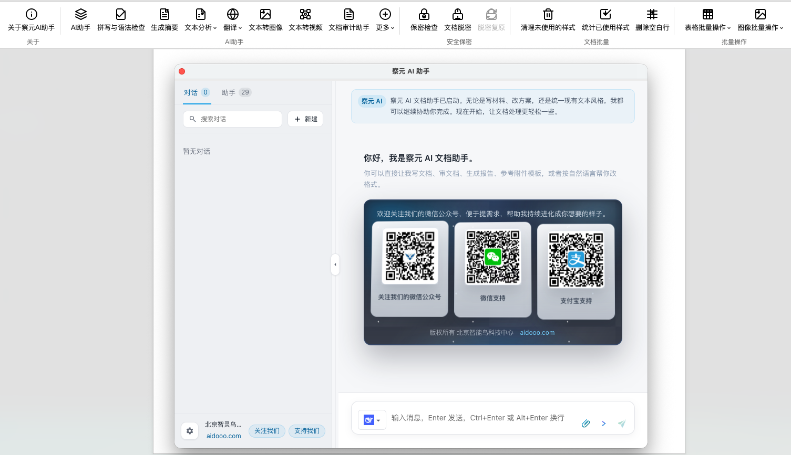 | The **AI assistant chat pane** opened from the WPS Writer "察元AI助理" tab (welcome page) |
|  | **Text analysis** menu: rewrite / expand / condense / AI-trace check / keyword extraction |
| 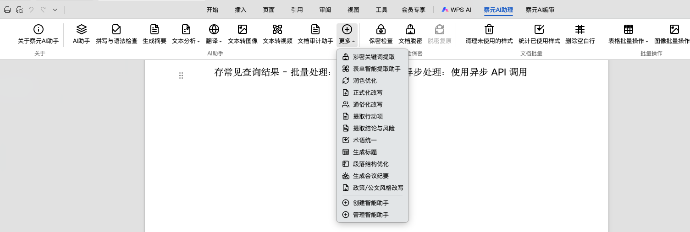 | **More** menu: keyword extraction for redaction / form extraction / polish / meeting minutes / assistant management |
|  | The "察元AI编审" tab: form assist / template management / rule management / settings |
| 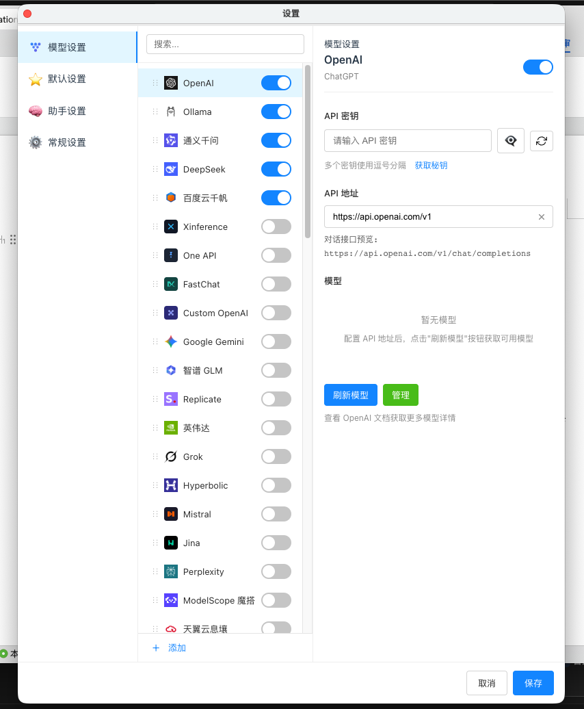 | Settings → Models: **provider & key management** (OpenAI / Ollama / Qwen / DeepSeek…) |
| 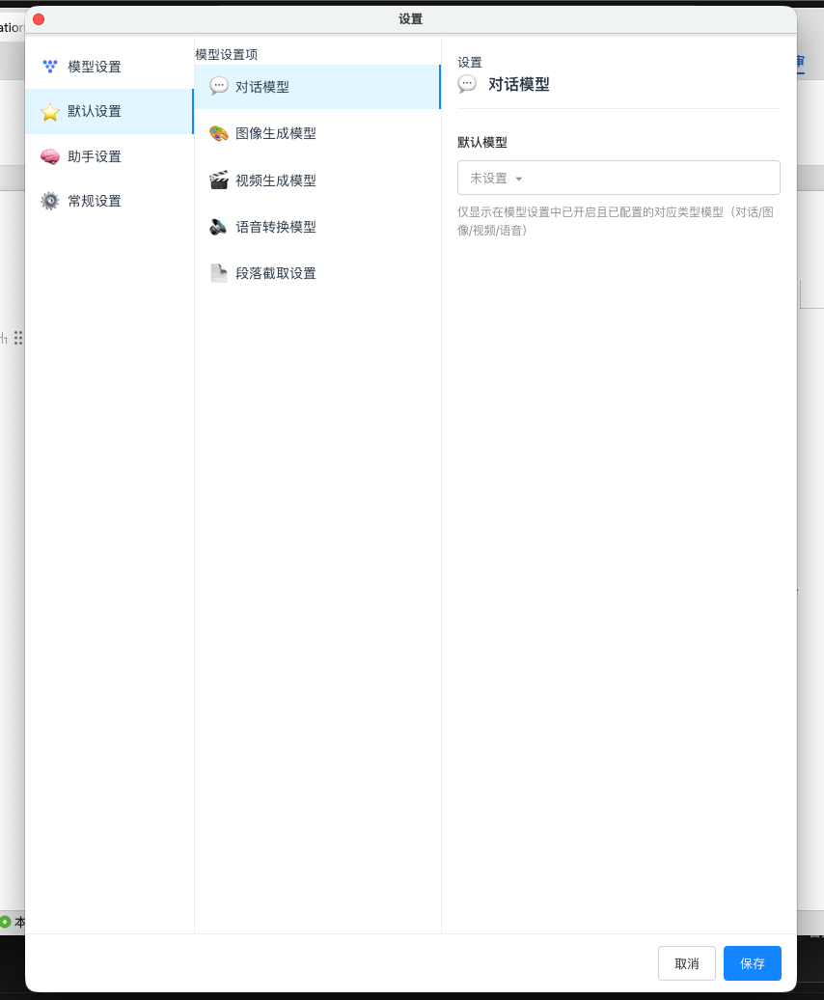 | Settings → Defaults: **per-task default models** (chat / image / video / speech / truncation) |
| 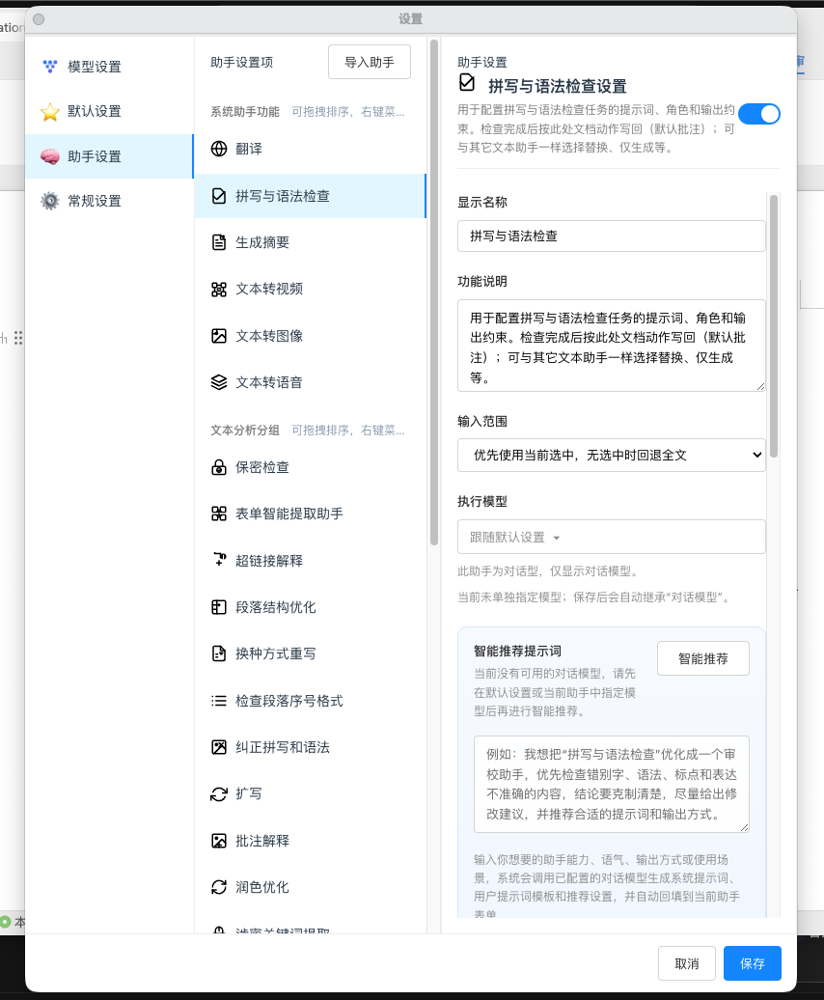 | Settings → Assistants: **prompt / input scope / model** per assistant |
| 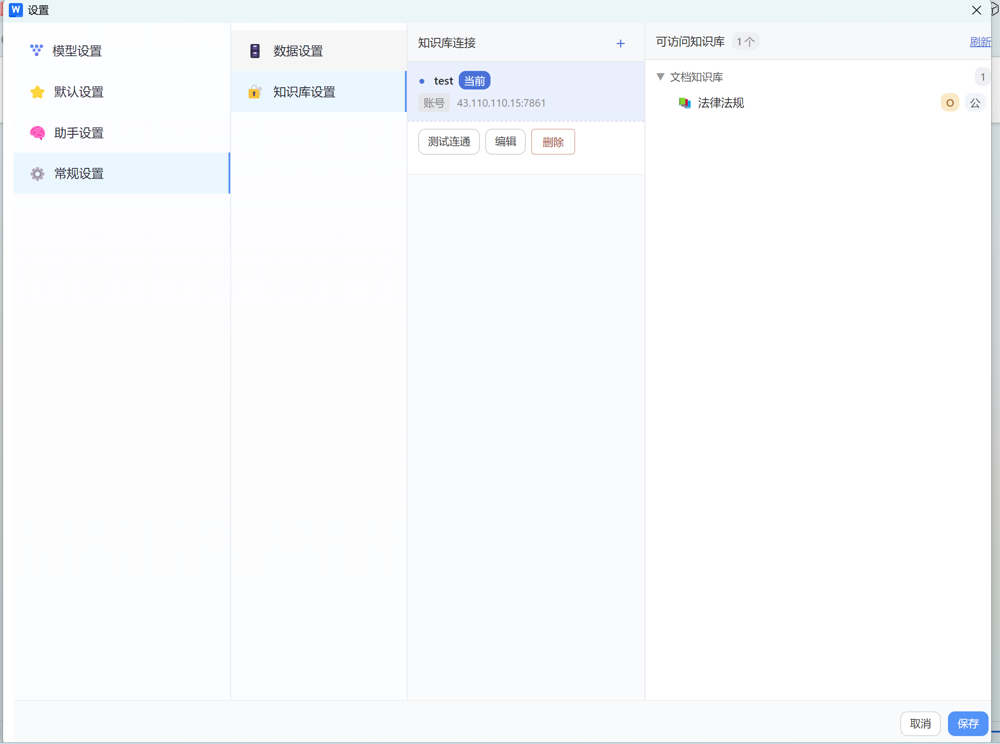 | Settings → Knowledge base: **connection list** and accessible KBs |
| 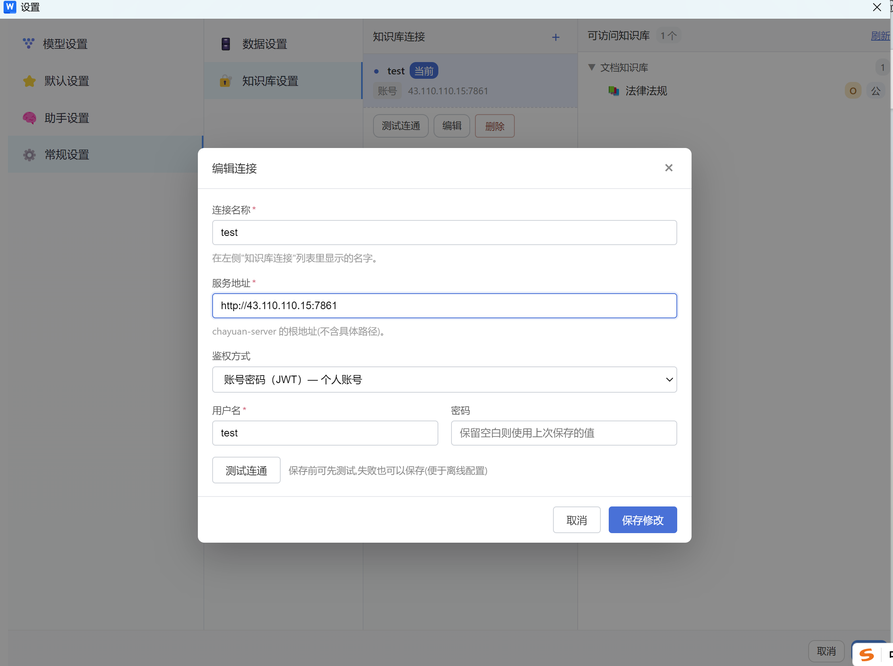 | **Edit KB connection**: server address, JWT / HMAC auth, connectivity test |

### Chayuan ecosystem web workbench (desktop / network editions)

| Screenshot | Description |
|:---:|---|
| 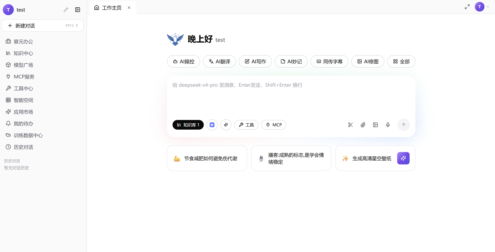 | Chayuan web workbench **home** (AI control / translate / write shortcuts) |
| 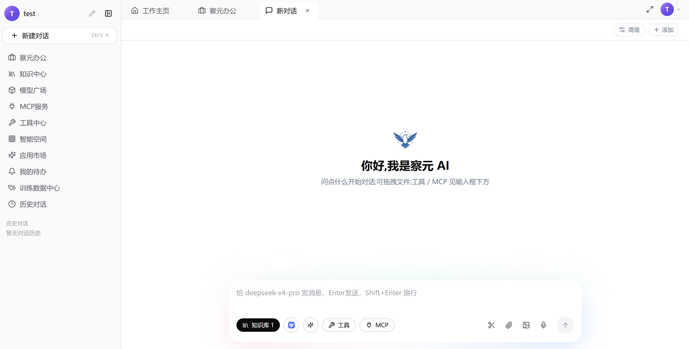 | Web **new chat** (knowledge base / tools / MCP inputs) |
| 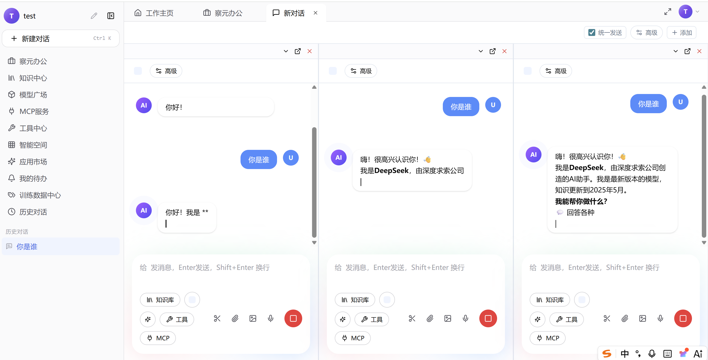 | **Side-by-side multi-model** comparison chat |
| 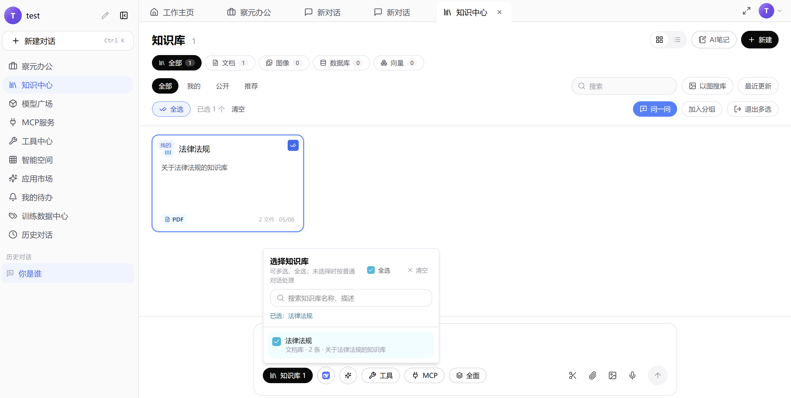 | Knowledge center: **select knowledge base** |
| 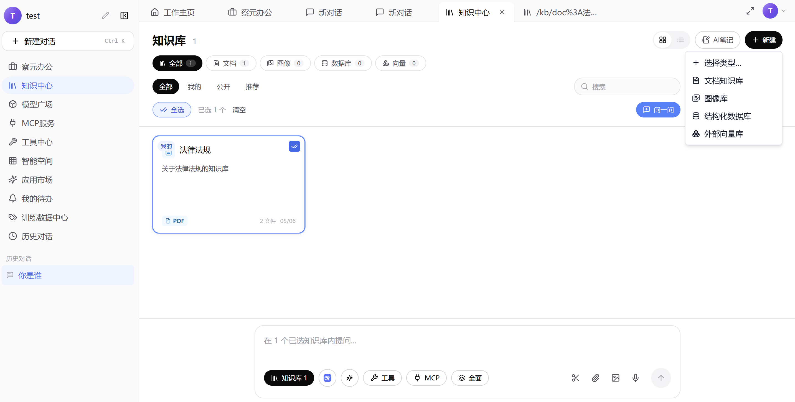 | Create: document KB / image library / structured DB / external vector store |
| 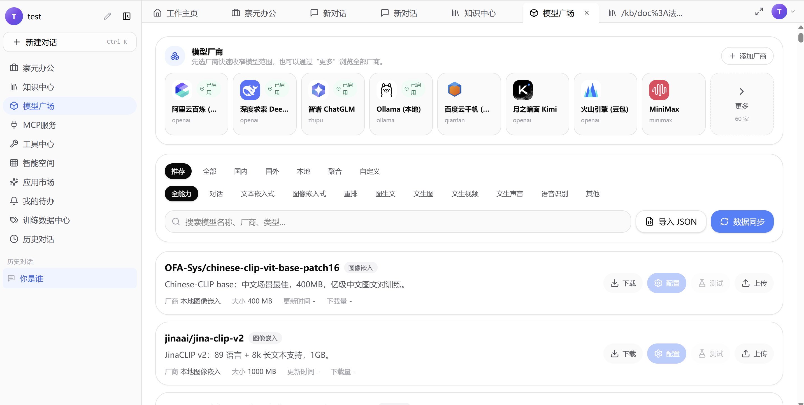 | **Model marketplace**: provider cards with download / configure / test |
| 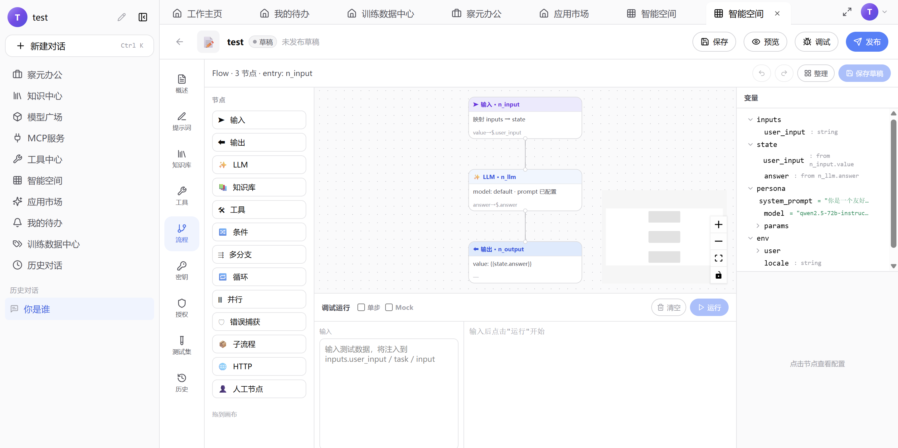 | **Flow orchestration canvas** in the smart workspace |
| 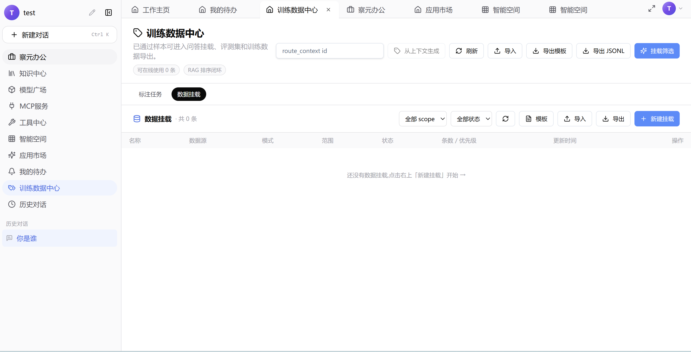 | **Training data center**: data mounting |

> Screenshots may differ slightly from the running software; the app itself is authoritative. The in-app About page ships its own built-in previews (`public/images/about/`).

---

## 4. Installation & quick start

### 4.1 Three-platform installers (recommended, no Node.js needed)

| Platform | Installer | Notes |
|---|---|---|
| Windows | `chayuan-<version>-windows-x64.exe` | Self-extracting installer; sidecar is a GUI-subsystem binary (no console window) |
| macOS | `chayuan-<version>-macos-<arch>.pkg` | arm64 / x86_64; includes container repair script `scripts/repair-mac-jsaddons-container.sh` |
| Linux | `chayuan-<version>-linux-<arch>.deb` | deb package; postinst fixes multi-registration sources so all three panes work after upgrade |

**Download:** official site [https://aidooo.com](https://aidooo.com) · [GitHub Releases](https://github.com/zhgyuhuii/chayuan-wps-releases/releases) · [Baidu Netdisk](https://pan.baidu.com/s/5kGNUqSLs7-6g8RNh5FsBcA)

The installer automatically: extracts the add-in into the jsaddons directory + writes `publish.xml` → extracts the `chayuan-mcp` binary and **registers auto-start** (Windows `HKCU\Run` / macOS LaunchAgent `com.chayuan.mcp` / Linux systemd --user) → four-level health check (jsaddons → `/healthz` → MCP `initialize` handshake → bridge tools). It stops the old agent service and clears port 62588 before installing, eliminating "installed but still the old version".

**Three steps to start:** ① install and open WPS → ② the "察元AI助理" tab appears; click "AI助手" → ③ configure a model in Settings (or use local Ollama right away) and start chatting.

### 4.2 Run from source (developers)

```bash
npm install
npm run dev            # vite dev server, http://localhost:3890
npm run build
npm run build:wps      # WPS add-in bundle
```

For debugging across all three hosts (Writer/Spreadsheet/Presentation), do **not** use `wpsjs debug` (it registers a single host):

```bash
npm run dev:debug                # vite + writes 3-host debug registration + launches WPS
npm run dev:debug -- --restore   # finish debugging, restore the production publish.xml
```

> On first load in the Spreadsheet/Presentation hosts WPS may show a "trust add-in" prompt (authaddin.json is tracked per host) — choose Trust.

---

## 5. Local MCP document agent (for external AI agents)

Chayuan ships a **local MCP (Model Context Protocol) document agent server** that exposes WPS document reading, locating, replacing, commenting, proofreading, knowledge-base retrieval, spreadsheet & presentation operations, template-based generation, and file parsing as a standard **Streamable HTTP MCP** interface. Any MCP-capable AI agent — **Claude Code, OpenAI Codex, Cursor, Cline, Hermes, OpenClaw**, etc. — can **work directly inside your WPS documents** with a single URL: open documents, read content, flag typos as comments, batch replace, insert table rows/columns / merge cells by plain language, cross-proofread multiple documents, or generate a whole new document from your template.

- **No auth required**: listens only on `127.0.0.1:62588` — localhost is the trust boundary; one URL, no token, no command line, no stdio.
- **Fully offline**: the sidecar runs on the same machine as WPS; documents and keys never leave the domain — fits air-gapped / intranet / government deployments.
- **Auto-starts with install**: registered as an OS auto-start service; **no Node.js needed** (single-file binary for 5 platforms).
- **Write-confirmation discipline**: every write goes "preview → confirm (`confirmed:true`) → commit", with each confirmed write appended to the `audit.jsonl` audit log.

### 5.1 One-line connection (all MCP clients)

Server: `http://127.0.0.1:62588/mcp` · Health check: `GET http://127.0.0.1:62588/healthz` (should return `online`)

**Claude Code:**

```bash
claude mcp add --transport http chayuan-wps-mcp http://127.0.0.1:62588/mcp
```

or in a project / user `.mcp.json`:

```json
{
  "mcpServers": {
    "chayuan-wps-mcp": { "url": "http://127.0.0.1:62588/mcp" }
  }
}
```

**OpenAI Codex (`~/.codex/config.toml`):**

```toml
[mcp_servers.chayuan-wps-mcp]
url = "http://127.0.0.1:62588/mcp"
```

**Cursor (`.cursor/mcp.json` or Settings → MCP → Add):**

```json
{
  "mcpServers": {
    "chayuan-wps-mcp": { "url": "http://127.0.0.1:62588/mcp" }
  }
}
```

**Cline / Hermes / OpenClaw / Claude Desktop and other clients:** create an MCP server of type **HTTP / Streamable HTTP** with URL `http://127.0.0.1:62588/mcp` — no token, no command line, no stdio.

**Verify with MCP Inspector:**

```bash
npx @modelcontextprotocol/inspector
# Choose Streamable HTTP, enter http://127.0.0.1:62588/mcp, click Connect
```

> **Troubleshooting**: if it won't connect, make sure WPS is open and the Chayuan add-in is loaded (`/healthz` returns `online`). For remote machines, proxy through localhost or set `CHAYUAN_MCP_PORT`. Full connection docs: [docs/mcp-connection.md](docs/mcp-connection.md); authoritative tool catalog: [docs/user-tutorials/W39-MCP工具面总览.md](docs/user-tutorials/W39-MCP工具面总览.md).

### 5.2 Tool catalog (sidecar v0.13.0)

**Scale**: 69 tools defined internally; **53 visible** via `tools/list` (17 fine-grained tools aggregated into domain tools, 33 legacy names kept as aliases — 86 callable names in total).

| Group | Tools | Description |
|---|---|---|
| Host & health | `wps_status` `wps_launch` | Layered health (sidecar / agent / three hosts / active document / window); cold-start WPS and wait for the add-in |
| Document lifecycle | `document_open` `document_ensure_open` `document_list_open` `document_activate` `document_meta` `document_save` | Open / ensure open / list open / switch / metadata / save & save-as |
| Read & locate | `document_list_paragraphs` `document_chunks` `document_get_text` `document_locate` | Paragraph list with anchors, chunked paging for long documents, full/selection text, term locating with multi-hits |
| Write-back | `document_replace` `document_insert` `document_apply_ops` | Replace anchored text, insert relative to anchor or at end, **batch write ≤200 ops** (replace / comment / comment-replace / insert-after) |
| Formatting | `format_read` `format_run` `format_para` `format_apply_ops` `system_fonts_list` | Read formats, run-level / paragraph-level formatting, batch format writes, system fonts |
| Proofreading | `proofread_run` `proofread_apply_comments` `proofread_job_poll` | dryRun issue list → write as WPS comments (needs confirmed) → async job polling |
| Domain tools (17) | `comment` `revision` `layout` `nav` `toc` `bookmark` `table` `caption` `field` `image` `hyperlink` `headerfooter` `watermark` `style` `export` `spreadsheet` `presentation` | Each takes an `action` parameter; `table` has 12 actions (sliced reads + row/column insert + cell merge + widths + export); `spreadsheet` (ET host) has 23 actions (6 read / 17 write, incl. encrypt/decrypt save and charts); `presentation` (WPP host) has 23 actions (4 read / 19 write, incl. page-by-page generation, full-bleed images, speaker notes, slideshow, export) |
| Redaction | `declassify_status` `declassify_preview` `declassify_apply` `declassify_restore` | Preview without writing → apply with confirmation (password + keywords) → restore with password; local trusted channel only |
| KB & assistants | `kb_retrieve` `assistants_list_domains` `assistants_search` `assistants_get` | Retrieve KB passages; the 4,526-assistant domain catalog / search / full-definition export |
| Images & assets | `image_search` `generate_image` | Web image search saved locally; generation via the configured image model (auto 16:9 on the Presentation host) |
| Template & files | `template_generate` `file_parse` | Generate a whole new document from a pptx/docx/xlsx template + materials, auto-opened (multi-round review); parse local files into model-readable text (docx/xlsx/pptx/pdf/eml/zip, etc.) |
| Internal | `chat_turn` | Assistant-pane internal chat turn (not public) |

Also included: **Resources** (`chayuan://wps/health`, `chayuan://guide/*`, `chayuan://assistants/*`) · **Prompts** (`para_translate_insert_after`, `open_local_document`) · **Error codes** (`WPS_AGENT_OFFLINE` / `DOCUMENT_TOO_LARGE` / `LOCATE_MISMATCH` / `LICENSE_REQUIRED` / `MODEL_NOT_CONFIGURED` / `CONFIRMATION_REQUIRED`).

### 5.3 Use cases & prompts (copy and adapt)

Once connected, talk to the currently open WPS document in plain language. Recommended default: **preview / dryRun first, then confirm before writing comments or changing text**; always keep human review for classified or final documents.

| # | Scenario | Example prompt |
|---|---|---|
| 1 | Typos & homophones | "Proofread this document for typos and flag each with a comment showing the suggested fix" |
| 2 | Table cells | "Focus on typos inside table cells; pin each comment to the exact wrong character" |
| 3 | Preview first | "Run a dryRun proofread, give me the issue list, don't change the text yet — I'll confirm before you write comments" |
| 4 | Punctuation | "Check punctuation (mixed CJK/Latin marks, quotes, brackets) and flag issues as comments" |
| 5 | Numbering style | "Check heading/clause numbering (一、（一）、1.) for hierarchy consistency" |
| 6 | Grammar | "Check for faulty sentences, missing subjects, and bad collocations; suggest fixes as comments" |
| 7 | Consistency | "Cross-check numbers, dates, and names for internal contradictions" |
| 8 | Figure-table match | "Verify the body text matches the table contents" |
| 9 | Official-document format | "Check against government-document conventions: title, recipients, signature block, attachment notes" |
| 10 | Contract clauses | "Check the contract for missing parties, amounts, terms, and breach clauses; output a risk list" |
| 11 | Translate & insert | "Translate to English and insert the translation after each paragraph; unify terminology first" |
| 12 | Polish | "Polish the full text without changing meaning; explain changes in comments" |
| 13 | Summarize | "Generate a ≤300-word summary and insert it at the top (preview first)" |
| 14 | Find & replace | "Find every occurrence of X, show me the list, then replace all with Y after I confirm" |
| 15 | Sensitive info | "Find anything resembling ID numbers, phone numbers, or bank cards and comment on them" |
| 16 | Redact & restore | "Preview a redaction over these keywords first; after I confirm, apply it with a password" |
| 17 | KB cross-check | "Check this document against the knowledge-base regulations and cite clauses in comments" |
| 18 | Multi-document | "Open these documents in the directory and cross-check typos and terminology consistency" |
| 19 | Template generation | "Use 公司模板.pptx plus the attached product material to generate a 10-page product deck, keeping the template's master and colors; confirm the outline with me first" |
| 20 | Final pre-release check | "Final check: typos, punctuation, numeric consistency, text-vs-table match; output all as comments plus a severity-ranked summary" |

> The same tasks can be done inside the add-in itself (spell & grammar check / smart comments / custom assistants) without an external agent.

---

## 6. The wps-skill-chayuan skill pack: one command, three things done

`wps-skill-chayuan` is Chayuan's **portable skill pack**: one skill definition (`SKILL.md`) plus a 4-step installer script, so **Claude Code / Cursor / OpenAI Codex** can use Chayuan's 53 document tools out of the box. **One script run prepares all three**: the WPS add-in, the auto-started MCP service, and the skill files for your AI client.

> 📖 Full illustrated guide (install → configure → verify → use): [`docs/wps-skill-chayuan-guide.md`](docs/wps-skill-chayuan-guide.md).

| Starting point | After running the installer you have |
| --- | --- |
| **Install the skill** (wire your AI client to WPS) | ✅ Skill files placed into Claude/Cursor/Codex　＋　✅ WPS add-in installed　＋　✅ MCP auto-start registered |
| **Install the add-in** (Chayuan inside WPS) | ✅ Add-in in place　＋　✅ MCP auto-start registered　＋　✅ One-click skill deployment to local AI clients |

**Installing the skill installs the add-in; installing the add-in brings the skill.** Both routes converge: one script, and the **WPS add-in + MCP auto-start service + AI client skill** are all in place.

### One-line install (end users, no repo clone needed)

**Windows (PowerShell):**

```powershell
& {[Net.ServicePointManager]::SecurityProtocol=[Net.SecurityProtocolType]::Tls12;$w=New-Object Net.WebClient;$w.Encoding=[Text.Encoding]::UTF8;$s=$w.DownloadString('https://gitee.com/cloudshd/chayuan-wps-releases/raw/master/scripts/install-wps-skill-chayuan.ps1');if($s.Length -and $s[0]-eq[char]0xFEFF){$s=$s.Substring(1)};& ([scriptblock]::Create($s)) -Fetch}
```

> Why not plain `iwr | iex`? Windows PowerShell 5.1 decodes `iwr` responses as GBK by default, mangling the UTF-8 BOM and breaking the scriptblock. We use `WebClient` with explicit UTF-8 decoding (BOM stripped) instead — bypassing execution policy without mojibake.

**macOS / Linux:**

```bash
curl -fsSL https://gitee.com/cloudshd/chayuan-wps-releases/raw/master/scripts/install-wps-skill-chayuan.sh | bash -s -- --fetch
```

> Overseas / direct GitHub: swap the URL for `https://raw.githubusercontent.com/zhgyuhuii/chayuan/main/scripts/install-wps-skill-chayuan.{ps1,sh}`. The script downloads the portable pack with multi-source fallback (Gitee → aidooo → GitHub, **sha256-verified**) → installs the add-in + MCP auto-start + deploys skills to Claude/Cursor/Codex.

**Already cloned this repo?** Run the local script (equivalent):

```powershell
powershell -ExecutionPolicy Bypass -File scripts\install-wps-skill-chayuan.ps1 -Fetch
```
```bash
bash scripts/install-wps-skill-chayuan.sh --fetch
```

`-SkillOnly` deploys skill files only; `-Version 6.1.2` pins a version.

### The script's four steps (one script)

1. **Install the add-in** — extract into jsaddons + write `publish.xml`; WPS loads Chayuan on open.
2. **MCP auto-start** — extract the `chayuan-mcp` binary + register auto-start (Win `HKCU\Run` / macOS LaunchAgent / Linux systemd --user); **no Node.js needed**.
3. **Four-level health check** — jsaddons → `/healthz` → `initialize` handshake → bridge tools; verified right after install.
4. **Deploy the skill** — auto-detect Claude / Cursor / Codex and place the skill files.

---

## 7. The Chayuan ecosystem: one engine, four SKUs

**Chayuan AI Document Assistant is not an isolated plugin.** The vendor describes the whole Chayuan AI line as "**one engine, four SKUs**" — the same query engine (five knowledge-source types: document / structured / vector / office / image) + model gateway + local capabilities, applied per scenario. **This add-in is SKU #1, the "document assistant"**, bringing those capabilities into the WPS document you are writing.

| # | SKU | Project / entry | User pain it solves |
|---|---|---|---|
| 1 | **Chayuan AI Document Assistant** (this project) | [chayuan-wps](https://github.com/zhgyuhuii/chayuan-wps-releases) (WPS add-in) | "Don't make me bounce between a browser and my document — fix, check, and write back right here in this government report / contract." |
| 2 | **Chayuan AI Desktop** | [chayuan-desktop](https://github.com/zhgyuhuii/chayuan-desktop-releases) (standalone installer) | "Runs on my own machine even offline; not one byte of keys or documents leaves this computer." |
| 3 | **Chayuan AI Server** | [chayuan-desktop](https://github.com/zhgyuhuii/chayuan-desktop-releases) (Docker network edition) | "One deployment for the whole department; shared knowledge base; no per-seat / per-token billing." |
| 4 | **Chayuan AI Premium** | [chayuan-desktop](https://github.com/zhgyuhuii/chayuan-desktop-releases) (Docker network + online office) | "Hundreds to tens of thousands of users, each with a browser workspace — governed and auditable." |

**How this add-in cooperates with Desktop / Server:**

```
        ┌──────────────────────────────────────────────┐
        │  Chayuan AI Document Assistant (this add-in) │
        │  • Lives inside WPS Writer/ET/WPP: pane+Ribbon│
        │  • Selection / full-text context awareness    │
        │  • Write-back: insert/replace/comment/append  │
        └───────────────────┬──────────────────────────┘
                            │  HTTP/REST · set "Server address" to:
                            │  • Standalone → http://127.0.0.1:62581 (local, no login)
                            │  • Network   → https://your-deployment (team, with login)
                            │  /api/v1/kb-query/search · /api/chat/completions
                            ▼
        ┌──────────────────────────────────────────────┐
        │  Chayuan Desktop / Server (chayuan-desktop)  │
        │  • The same chayuan-server engine             │
        │  • KB / model gateway / tools / embed / rerank│
        │  • Standalone: user dir; network: multi-user  │
        └──────────────────────────────────────────────┘
```

- **One knowledge base, two places**: Desktop/Server run the embedding / retrieval / rerank sidecar locally or team-wide; the add-in connects by pasting one endpoint — documents and chat share the same KB, with keys and documents never leaving your domain.
- **Standalone or combined**: the add-in works alone with your own Ollama / cloud models; add Desktop/Server to gain unified retrieval across five knowledge-source types, citation bubbles, one-click source download, and other enterprise capabilities.

> See the chayuan-desktop repo README and its `docker/README.md` (one-command network deployment) for details. Workbench UI previews are in the [screenshots section](#3-screenshots).

---

## 8. Version history

**Current version: `6.1.2`** (2026-10-28) · MCP catalog `0.13.0`

### v6.1.2 — Attachment-parsing pipeline fixes & installer hardening

- **Attachment context now reaches the MCP agent pipeline**: "what's in attachment 1" works — uploaded attachments (with extracted text) are injected into the system prompt across all three dispatch paths.
- **Task timeouts aligned**: large PDF parsing and legacy doc/ppt conversions are no longer killed by short default timeouts; redaction watchdogs relaxed; write locks released precisely by lockId.
- **Installers stop the old service first**: `launchctl bootout` → `pkill` patterns → lsof force-kill of port 62588 with wait-for-release; ends "installed but still old".
- **Silent container failures made loud**: when the macOS sandboxed-WPS jsaddons container write fails, the install log warns with repair guidance; new `scripts/repair-mac-jsaddons-container.sh` (status / repair / rollback).
- **Linux deb upgrade governance**: postinst now fixes WPS multi-registration sources, curing the three-host blank-pane issue after upgrades.

### v6.1.0 — Template-based generation upgrade

- Generate a whole document set from your template file (.pptx / .docx / .xlsx) + one sentence in the home chat; host routing is automatic and offline hosts are launched.
- Shape-level analysis and content mapping; invisible watermarks preserved; new text inherits template fonts.
- Multi-round pre-delivery review: machine audit + self-healing + AI review, 3 rounds default (max 4), per-dimension ✓ / ✗.
- Delivery preserves template design (byte-level copy + fill); the conversation follows into the new document.

### v6.0.0 — Three-host AI workbench

- **Spreadsheet assistant** (66 recipes + six primary buttons + document security) and **Presentation assistant** (81 recipes + AI-generate PPT + whole-deck tools) on the shared agent core.
- **Three-tier image sourcing + web resource search**: model → web → SVG; nine configurable search providers.
- **file_parse**: 1-8 paths or attachment aliases; full format matrix; three-tier token budget.
- **Local KB auto-discovery** (port 52582) + **multi-document session isolation** + unified docking.

### v5.x — Embedded agent · MCP hardening · docking

- **Embedded agent**: full agent loop (planning / tool calls / cross-turn memory / task lists) that writes back into documents.
- **Write-back safety**: write lock + FIFO + OCC validation; pre-write snapshots with undo; three permission levels; sidecar minimal-token auth + caller auditing.
- **MCP hardening**: three-level readiness diagnostics, full-chain self-healing, four real-machine crash root-causes fixed; packages rebuild the sidecar binary automatically.
- **Docking**: floating ↔ left/right dock one-click, dock width = half the screen.
- **Local engine one-click setup** (Ollama / LM Studio), embedded online support chat, upgrade banner.

### Earlier releases

[v6.0.0 release notes](RELEASE_NOTES_v6.0.0.md) · [v4.1 (table-structured write-back · skill two-way bootstrap)](RELEASE_NOTES_v4.1.md) · [v4.0.0 (local MCP document agent)](RELEASE_NOTES_v4.0.md) · [v3.0 (remote KB RAG)](RELEASE_NOTES_v3.0.md) · [CHANGELOG.auto.md](CHANGELOG.auto.md)

---

## 9. Models & providers

Available models depend on the API keys, base URLs, and providers configured in **Settings**. **A fully offline setup needs only a local or intranet OpenAI-compatible service**; keys are stored locally.

| Category | Examples |
|---|---|
| Local / offline | **Ollama** (11434), **LM Studio** (1234), **Xinference** (9997), FastChat (8000), any OpenAI-compatible intranet gateway (**OneAPI**, New API, etc.) |
| Cloud (OpenAI-compatible) | OpenAI, **DeepSeek**, **Alibaba Bailian / Qwen**, **Zhipu GLM**, **Kimi (Moonshot)**, Qianfan, Gemini, other compatible endpoints |
| Image / speech / video | Provider-specific modality endpoints; image generation supports Bailian-native and OpenAI-compatible dual routing |

- Provider groups and default model lists live in `src/utils/defaultModelGroups.js`; icons and enablement in `src/utils/modelSettings.js`.
- Model cards accept an optional "context window (tokens)" field; the panel budgets at min(window × 25%, 32k); external MCP clients self-report via `budgetTokens`.
- A split workflow (sensitive passages on a local model, public passages on a cloud model) is supported — clarify responsibility boundaries in your organizational policy.

---

## 10. Positioning vs. common office AI

> The table summarizes each product's **commonly available form** for selection reference only; it is not a commitment about, or ranking of, any third party. Billing, data residency, and private deployment depend on each vendor's official docs and contracts.

| Dimension | **Chayuan AI Document Assistant** (this project) | **WPS AI** (Kingsoft built-in) | **Microsoft 365 Copilot** | **Feishu / Tencent Docs / Notion AI** | **General LLM web/app** (Doubao, Qwen, Kimi…) |
|--------|---|---|---|---|---|
| Form | Third-party **WPS** add-in, three hosts, self-distributable | Native WPS capability, tied to membership | Copilot inside M365 Word etc. | AI inside online collaborative editors | Standalone chat; no native write-back into local documents |
| Offline / intranet inference | **First-class**: Ollama / LM Studio / Xinference / OneAPI | Per Kingsoft's official enterprise offerings | Per Microsoft's official enterprise offerings | Vendor cloud required | Vendor cloud APIs |
| User-chosen multi-model / gateway | ✅ Multi-provider + OpenAI-compatible base URL | Defined by Kingsoft | Defined by Microsoft tenant policy | Defined by each product | Vendor-specific |
| **Write-back inside WPS** (insert/replace/comments/linked comments) | ✅ Nine write-back actions | ✅ (action set per WPS version) | ❌ (host is Word) | ❌ (host is online docs) | Usually ❌, copy-paste only |
| Open source & auditable | ✅ **Apache-2.0**, this repo | ❌ | ❌ | ❌ | ❌ |
| External agents via MCP | ✅ 127.0.0.1:62588, 53 tools | ❌ | ❌ | ❌ | ❌ |
| Best for | WPS users wanting intranet models / OpenAI-compatible gateways / fine-grained write-back and review loops | WPS users wanting zero-install official AI | M365 organizations | Online collaboration teams | General chat and out-of-editor drafting |

**Relationship with WPS AI**: Chayuan is an **independent third-party add-in** (this repo); WPS AI is Kingsoft's built-in capability. They are fully independent (accounts, billing, models, data paths) and can coexist in the same WPS.

**Chayuan in one line**: deep WPS-native integration + offline-first + nine write-back actions with comment anchoring + integrated form review + a local MCP server drivable by external agents — a governance-minded document AI that is **controllable, auditable, and offline-capable**.

---

## 11. Development guide

### Requirements

- **Node.js** + **npm** (current LTS recommended); **Bun** for building MCP binaries (`npm run mcp:build-binary`).
- **WPS Office** (add-in host; debuggable on Windows / macOS / Linux).
- The **wpsjs** toolchain is recommended for debugging and publishing.

### Common commands

```bash
npm install
npm run dev              # dev server http://localhost:3890
npm run build            # frontend build
npm run preview
npm run build:wps        # WPS add-in bundle (--online / --offline / --debug variants)
npm run lint && npm run format

# —— Three-platform installers (cross-buildable on one machine) ——
npm run build:wps-all        # frontend build + release/install-staging (shared by 3 platforms)
npm run build:wps-exe        # Windows self-extracting installer release/chayuan-<ver>-windows-x64.exe
npm run build:wps-pkg-macos  # macOS installer     release/chayuan-<ver>-macos-<arch>.pkg
npm run build:wps-deb        # Linux deb           release/chayuan-<ver>-linux-<arch>.deb

# —— Local MCP document agent ——
npm run mcp:sidecar          # dev mode node server.mjs (127.0.0.1:62588)
npm run mcp:build-binary     # cross-compile 5-platform single-file binaries (needs Bun)
npm run mcp:selftest         # real-machine self-test (:quick / :tools variants)

# —— Self-checks ——
npm run doctor               # project doctor (:quick for fast mode)
npm run test:agent-loop      # agent-loop smoke
npm run test:write-lock      # document write-lock smoke
```

### Project layout

| Path | Contents |
|---|---|
| `src/` | Vue 3 frontend (46 routes: assistant pane, settings, review, task center, control panel…) |
| `public/ribbon*.xml` | Ribbon configs for the three hosts (Writer / Spreadsheet / Presentation) |
| `mcp-sidecar/` | Local MCP server (`server.mjs` + `lib/toolCatalog.mjs` with 69 tool definitions) |
| `docs/user-tutorials/` | **44 user tutorials** (W01-W44, 11 domains, levels P0-P2) covering install to MCP |
| `docs/mcp-connection.md` | MCP connection & troubleshooting |
| `skill-chayuan/` | wps-skill-chayuan portable skill pack |
| `scripts/` | Installer builds / self-tests / repair scripts |
| `screenshots/` | README screenshots (self-contained directory) |

---

## 12. FAQ

**Q1: What's the relationship between Chayuan AI and WPS AI? Do I need to uninstall WPS AI?**
Chayuan is an **independent third-party open-source add-in**, fully separate from Kingsoft's built-in WPS AI (accounts, billing, models, and data paths differ). They can coexist; neither needs to be uninstalled.

**Q2: Does it require internet? Does data go to your servers?**
No internet required. **Offline / intranet first** is a design baseline: connect Ollama / LM Studio / Xinference local models and the full chat + assistant flows work; keys are stored locally; document content goes only to **the model endpoints you configure**. Chayuan itself operates no cloud relay.

**Q3: Which LLMs are supported?**
Any **OpenAI-compatible** chat endpoint (DeepSeek, Qwen, Zhipu GLM, Kimi, OpenAI, Gemini, OneAPI/New API gateways, etc.); image / speech / video use their modality endpoints; image generation supports Bailian-native and OpenAI-compatible dual routing.

**Q4: How do I let Claude Code / Cursor / Codex operate on my WPS documents?**
With WPS and Chayuan open, register one MCP server: `claude mcp add --transport http chayuan-wps-mcp http://127.0.0.1:62588/mcp` (Cursor / Codex configs in [section 5](#5-local-mcp-document-agent-for-external-ai-agents)). Then just say "proofread this document and write comments".

**Q5: Is the MCP service a security risk?**
It listens only on `127.0.0.1` (localhost is the trust boundary; remote machines cannot connect directly); every write requires preview → confirm → commit and is logged to `audit.jsonl`; redaction tools are reachable only from the local trusted channel. For stricter isolation, set `CHAYUAN_MCP_PORT` and apply local firewall policy.

**Q6: Can AI proofreading edit my text directly? Will it break the document?**
Yes it can, but the default path is "check → preview issue list → you confirm → write comments or correct text". Write-back has four safeguards: serialized write locks (no cross-overwrites), pre-write snapshots (one-click undo), OCC validation (explicit conflict prompts), and three permission levels (default "confirm before change"). Start with dryRun.

**Q7: Which WPS versions and operating systems are supported?**
WPS Office on Windows / macOS (including Apple Silicon) / Linux. Official installers in [section 4](#4-installation--quick-start): Linux deb, macOS pkg, Windows self-extracting exe.

**Q8: What does "4,526 built-in assistants" mean?**
The Writer edition ships a **domain-assistant catalog**: professional prompt templates across 228 industry domains (finance, party-building, medical, bidding, government…), searchable via `assistants_search` and executed directly, or managed/exported/customized in "assistant management". Add 66 Spreadsheet recipes and 81 Presentation recipes — plus **unlimited custom assistants**.

**Q9: Can it handle legacy .doc / .ppt / .et files?**
Yes. `file_parse` and the cross-host pipeline **convert legacy formats via the corresponding WPS host automatically** (copy-based; originals untouched; the host is launched if offline).

**Q10: Is it free? What's the license? Do I need a commercial license?**
The source code is **Apache License 2.0** — free to use, modify, and commercialize (see [license section](#13-license-trademark--branding)). Some advanced capabilities are gated (local license verification + free quota); OEM / white-label / branding changes require separate written authorization.

**Q11: How do I batch-proofread dozens of documents?**
Two routes: ① in-add-in multi-document sessions with the task list; ② external agents via MCP ("open these documents in the directory and cross-check typos and terminology") — `document_apply_ops` takes up to 200 ops per call.

**Q12: After upgrading, features didn't change / panes are blank — what now?**
Installers already stop the old service and clear the port before installing. For leftovers: re-run the installer on Windows; run `bash scripts/repair-mac-jsaddons-container.sh` on macOS (container status / repair / rollback); re-run the deb on Linux. **Fully restart WPS** after upgrading.

**Q13: What do `CONFIRMATION_REQUIRED` / `WPS_AGENT_OFFLINE` mean?**
The first means the write tool needs `confirmed:true` to commit (by design — read the preview, then confirm); the second means WPS / the Chayuan add-in isn't connected to the sidecar — open WPS, confirm the add-in is loaded (`GET /healthz` returns `online`).

---

## 13. License, trademark & branding

### Copyright & license

**Product name (full legal name):** Chayuan AI Document Assistant（察元 AI 文档助手）; npm package `chayuan`.

**Open-source license:** the source code in this repository is licensed under the **[Apache License, Version 2.0](LICENSE)**. Subject to all its terms (retaining copyright notices, NOTICE files, patent grants, and liability limitations), you may freely use, modify, merge, publish, sublicense, and **use it commercially** (internal enterprise distribution, office integration, hosted or value-added services, etc.). If you have signed a separate commercial license, OEM, exclusive, or supplemental agreement with the rights holder, **that written agreement prevails**.

**Copyright & publisher:** developed and operated by **Beijing Zhilingniao Technology Center**（北京智灵鸟科技中心）. UI copy, default prompt templates, icons, and brand assets are protected by copyright and related intellectual-property law. **Website:** [https://aidooo.com](https://aidooo.com) · **WeChat official account:** 智灵鸟科技

**Disclaimer:** the software is provided "as is"; LLM output may be inaccurate or unsuitable. Confidentiality, compliance, and legal judgments belong to humans and formal procedures. Confidentiality check, redaction, and AI-trace check are **advisory aids only** — not classification decisions or forensic conclusions.

### The "察元 / Chayuan" brand mark

In **end-user-facing UI**, the mark "察元" and its fixed product designations (察元 AI / 察元 AI 文档助手 / 察元 AI 编审 / 关于察元 / 添加到察元 AI 助手, etc.) appear in ribbon groups and buttons, context menus, dialogs, and the About page; they are part of the **product's source identity**. **Without written authorization from the rights holder, redistributed or customized builds must not replace, remove, obscure, or misleadingly rewrite these fixed UI strings** (e.g., renaming the product while the software still points here). This does not restrict source-code modification allowed by Apache 2.0; but if you distribute **installable, end-user-facing builds**, you must either preserve the prominence of the brand marks or obtain prior written consent. For private deployments, white-labeling, or full UI localization involving brand fields, contact the vendor via the official website for **separate authorization terms**.

### Commercial use at a glance

| Scenario | Notes |
|------|------|
| Internal organizational use, intranet deployment | Generally allowed under Apache 2.0; mind key and data compliance |
| Commercial distribution, integration into products/services | Allowed under Apache 2.0 with its obligations; **brand marks** per the section above |
| Separate agreement with the rights holder | That agreement prevails (support, trademark scope, liability, etc.) |
| Third-party models & services | Each cloud provider / API vendor has its own terms and billing; unrelated to this project's open-source license |

---

## 14. Downloads & community

| Channel | Project | URL |
|---|---|---|
| Official site | Downloads / docs / business | <https://aidooo.com> |
| GitHub main repo (this project) | Chayuan AI Document Assistant · WPS three-host add-in | <https://github.com/zhgyuhuii/chayuan> |
| GitHub release mirror | Installers & portable skill pack releases | <https://github.com/zhgyuhuii/chayuan-wps-releases> |
| Gitee release repo | CN install scripts & portable pack | <https://gitee.com/cloudshd/chayuan-wps-releases> |
| Chayuan Desktop / Server | Standalone / Docker / online office | <https://github.com/zhgyuhuii/chayuan-desktop-releases> |
| Baidu Netdisk | Installer downloads | <https://pan.baidu.com/s/5kGNUqSLs7-6g8RNh5FsBcA> |

- Public technical questions: GitHub Issues on the relevant repo; business cooperation / enterprise licensing / OEM: official website.
- In-app: the sidebar "反馈及建议" (feedback) opens the official online support chat (falls back to a WeChat QR code when offline).
- Voluntary donations and follow channels are described on the official site and in-app.

<div align="center">

**Chayuan AI Document Assistant** · 察元 AI 文档助手 · Vue 3 + Vite · Apache-2.0 · Beijing Zhilingniao Technology Center

</div>
