<div align="center">


# 察元 AI 文档助手 · Chayuan AI Document Assistant

**WPS 文字 / WPS 表格 / WPS 演示三端 AI 智能加载项 · 内嵌文档智能体 · 本机 MCP 文档服务器**

在 WPS 编辑器内不换窗口完成 AI 对话、文档校对、批量修正、模板编制、知识库检索与正文写回；内置本机 MCP（Model Context Protocol）服务，可被 Claude Code、OpenAI Codex、Cursor 等外部 AI 智能体直接调用；**离线 / 内网优先**，全面兼容 Ollama、LM Studio、Xinference、OneAPI 等 OpenAI 兼容端点与主流云端大模型。

[](https://vuejs.org/)
[](https://vitejs.dev/)
[](package.json)
[](#五本机-mcp-文档智能体面向外部-ai-智能体)
[](LICENSE)
[](#四安装与快速上手)

</div>

> **关键词 / Keywords：** 察元AI · WPS 加载项 · WPS AI 插件 · WPS 智能体 · WPS 文档智能体 · WPS 文字 AI · WPS 表格 AI · WPS 演示 AI · AI 办公 · 文档 AI · 办公大模型 · AI 写作助手 · AI 校对 · 错别字检查 · 拼写检查 · 语法检查 · 公文校对 · 合同审查 · 多文档校对 · 批量修正 · 智能批注 · 文档批注 · 润色改写 · 扩写缩写 · 摘要生成 · 会议纪要 · 多语种翻译 · AI 生成 PPT · 一句话生成 PPT · Excel 公式助手 · 数据清洗 · 数据洞察 · 一键图表 · 模板编制 · 从模板生成文档 · 表单智能提取 · 文档审计 · 保密检查 · 文档脱密 · 敏感信息脱敏 · 知识库 RAG · 检索增强生成 · 本地知识库 · 本地大模型 · 离线大模型 · 内网部署 · 私有化部署 · 政企办公 AI · Ollama · LM Studio · Xinference · OneAPI · DeepSeek · 通义千问 · Qwen · 智谱 GLM · Kimi · OpenAI 兼容 · MCP 服务器 · Model Context Protocol · Claude Code · OpenAI Codex · Cursor · Cline · 文生图 · 文生视频 · 语音合成 · 察元 · 智灵鸟 · aidooo

**Language / 语言**

| Language | Document | 状态 |
|----------|----------|------|
| **简体中文（本文件，最完整）** | **[README.md](README.md)** | ✅ 随版本更新 |
| English | [README.en.md](README.en.md) | ✅ 随版本更新 |
| 日本語 | [README.ja.md](README.ja.md) | 历史版本，内容可能滞后 |
| Русский | [README.ru.md](README.ru.md) | 历史版本，内容可能滞后 |
| Deutsch | [README.de.md](README.de.md) | 历史版本，内容可能滞后 |
| Español | [README.es.md](README.es.md) | 历史版本，内容可能滞后 |
| Français | [README.fr.md](README.fr.md) | 历史版本，内容可能滞后 |

---

## 目录

- [一、30 秒了解察元 AI 文档助手](#一30-秒了解察元-ai-文档助手)
- [二、功能全景](#二功能全景)
- [三、界面截图](#三界面截图)
- [四、安装与快速上手](#四安装与快速上手)
- [五、本机 MCP 文档智能体（面向外部 AI 智能体）](#五本机-mcp-文档智能体面向外部-ai-智能体)
- [六、wps-skill-chayuan 技能包：一条命令，三件事就绪](#六wps-skill-chayuan-技能包一条命令三件事就绪)
- [七、察元 AI 生态：一套引擎，四档 SKU](#七察元-ai-生态一套引擎四档-sku)
- [八、版本历史](#八版本历史)
- [九、模型与供应商](#九模型与供应商)
- [十、与常见办公 AI 的定位对照](#十与常见办公-ai-的定位对照)
- [十一、开发指南](#十一开发指南)
- [十二、常见问题 FAQ](#十二常见问题-faq)
- [十三、许可、商标与品牌](#十三许可商标与品牌)
- [十四、下载与社区](#十四下载与社区)

---

## 一、30 秒了解察元 AI 文档助手

**察元 AI 文档助手**（npm 包名 `chayuan`）是运行在 **WPS Office** 内的第三方开源智能加载项（**Apache-2.0**，Vue 3 + Vite），由**北京智灵鸟科技中心**研发。它把大语言模型直接嵌进 **WPS 文字（Writer）、WPS 表格（ET/Spreadsheet）、WPS 演示（WPP/Presentation）** 三个组件：对话、校对、翻译、改写、摘要、生图、保密检查、批量操作、模板编制、知识库检索全部**不离开编辑器**完成，结果可按九种方式**写回正文**（插入 / 替换 / 批注 / 链接批注 / 追加等）。

| 你想要 | 察元给你的 |
|---|---|
| 在正写的文档里让 AI 直接干活 | 内嵌智能体对话窗：规划任务 → 调用工具 → **直接写回文档** |
| 查错别字、标点、病句 | 结构化拼写语法检查 + **多文档批量校对**，批注钉在具体错字上 |
| 一句话出一套 PPT / Word / Excel | 模板编制：给你的模板文件 + 一句话要求，形状级对位生成整套文档 |
| 让 Claude Code / Cursor 操作我的 WPS | 本机 **MCP 文档智能体服务**（53 个工具），一行 URL 接入 |
| 断网 / 内网 / 数据不出域 | Ollama / LM Studio / Xinference 等**本地模型**优先，密钥本地保存 |
| 公文 / 合同 / 涉密场景 | 保密检查、文档脱密与复原、表单审计，输出**保守可复核** |
| 处理几十份文档 | MCP 批量读写 + 批量校对 + 任务清单 / 任务编排 |

**核心数字（当前版本 6.1.2）：** 文字端内置领域助手 **4526 个**（覆盖 228 个行业领域）· 表格端助手配方 **66 个** · 演示端助手配方 **81 个** · 翻译 **52 种语言** · 写回动作 **9 种** · MCP 工具 **53 个**（对外实见）· 三平台安装包 **Windows / macOS / Linux**。

---

## 二、功能全景

### 2.1 三端一体：文字 / 表格 / 演示共用一套智能体内核

- **WPS 文字**：功能区两个选项卡——「察元AI助理」（关于 / AI助手 / 安全保密 / 文档批量 / 批量操作 5 个分组）与「察元AI编审」（表单辅助 / 模板管理 / 规则管理 / 察元设置 4 个分组），外加右键菜单快捷入口。
- **WPS 表格**：「察元AI助理」选项卡——AI表格助手、公式助手、数据洞察、一键图表、数据清洗、报表结论、一键美化、模板新建、文档安全（保密检查 / 加密工作簿 / 解密工作簿）、更多表格助手。
- **WPS 演示**：「察元AI助理」选项卡——AI演示助手、生成PPT、整套摘要、美化统一、口播稿、整套校对、结构诊断、模板新建、文档安全、更多演示助手。
- 三宿主停靠行为统一：对话窗支持**浮窗 / 左右停靠一键切换**，停靠面板宽 = 屏幕一半，与文档平分屏幕；Ribbon 按钮 118/118 语义化图标覆盖。

### 2.2 内嵌智能体对话（Agent，不只问答）

- **完整智能体循环**：对话窗内置 agent-core 内核——多轮规划、连续工具调用（每回合上限 100 步）、跨回合记忆，长任务一口气做完。
- **任务清单先列后做**：智能体首轮先列 todo 清单，边做边勾（N/M 实时进度），跨回合沿用未完成清单。
- **过程全透出**：工具调用与进度流式实时显示，等待卡显示经过时间；回复 Markdown 渲染。
- **多会话并行**：右栏多会话页签，各会话状态独立互不干扰；发送键即全车道停止键。
- **对话跟随文档**：会话按文档隔离（文件内身份），面板跨窗口切换自动跟随、切回即恢复；跨文档对话交接（生成完成自动打开新文档后，对话历史 15 分钟内跟到新窗格）。
- **附件与文档感知**：对话可带附件（回形针），可感知当前选区 / 全文；「添加到察元」右键随手把段落送入对话区延续追问；附件上下文贯通智能体管线（对话里说「附件1里有什么」直接可答）。

### 2.3 校对与写回：查得出，更要改得进文档

- **九种写回动作**：插入到光标处 / 替换选区 / 添加批注 / 链接形式批注 / 批注加替换 / 插入到每段后面 / 插入到文档最前面 / 追加到文末 / 仅生成结果——按单位留痕制度选择最弱侵入或最强留痕组合。
- **拼写与语法检查**：结构化输出可解析 JSON 问题清单，覆盖错别字、语法、标点、固定搭配；全文 / 选区两档；可写成批注（钉在具体错字上，表格单元格同样支持）或直接改正文。
- **多文档批量校对**：经 MCP 打开同一目录多份文档交叉校对，错别字与术语一致性一次处理。
- **写回安全**：文档写锁 + FIFO 排队 + OCC 写前校验（多个智能体同写一个文档不互相覆盖）；首次写回前自动快照，改坏随时撤销；权限三档可选（变更前确认 / 自动执行 / 完全访问）。
- **任务进度窗**：独立进度对话框，支持确认写回、逐项撤销、失败重试。

### 2.4 内置助手体系：4526 + 66 + 81，还能自定义

- **文字端 4526 个领域助手**（228 个行业领域清单，`assistants_search` 可检索、可导出）：按领域直接命中「财务函证 / 党务材料 / 招标文件 / 医疗文书…」专用提示词。
- **文本分析九件套**（Ribbon「文本分析」菜单）：换种方式重写、扩写、缩写、检查段落序号格式、AI 痕迹检查、批注解释、超链接解释、纠正拼写和语法、提炼关键词。
- **高频助手**：生成摘要、翻译（**52 种语言**动态菜单）、润色优化、正式化改写、通俗化改写、提取行动项、提取结论与风险、术语统一、生成标题、段落结构优化、生成会议纪要、政策公文风格改写等。
- **自定义助手**：自写系统提示与用户模板，选模型类型 / 输入来源（选区 / 全文）/ 输出格式（纯文本、Markdown、JSON）/ 写回动作 / 显示位置（Ribbon 主区 4 槽、右键菜单 4 槽、更多菜单）；支持导入导出分享、助手市场。
- **助手进化中心**：助手版本快照、评估、晋升、回滚；LLM 延迟监控（/perf）与进化大盘（/dashboard）。

### 2.5 多模态生成与配图保底

- **文本转图像 / 文本转视频 / 文本转语音**：按模型类型分流到对应端点，参数（画幅比例、时长、语音风格）在助手参数卡片中确认。
- **三级生图**（演示端配图链）：模型生图 → 网络搜图 → SVG 矢量自动降级；降级铁律「上级失败才降级，绝不静默换花钱来源」；图源四模式 auto / model / web / svg。
- **网络资源搜索**：Serper / Tavily / Linkup / SearXNG + Pexels / Pixabay / Unsplash + 必应 / Openverse 免 Key 兜底；独立开关、Key 本地保存、一键测活。

### 2.6 模板编制：对话直接出整套文档（v6.1 主线）

- **全宿主路由**：首页对话给一个模板文件（.pptx / .docx / .xlsx）+ 一句话要求，按模板类型自动路由到 WPS 文字 / 表格 / 演示；目标宿主离线自动拉起并等待就绪。
- **形状级剖析**：逐页剖析形状角色（标题 / 副标题 / 正文 / 装饰）与字号字体坐标——封面页吃文档标题、内容页吃章节标题、目录条目按序号对位；隐形水印识别为装饰保持原样；新内容按原形状容量截断，不撑爆版式；新文字写入主文本 run，继承模板中文字体。
- **打开前多轮核对**：机器审计（占位残留 / 文本溢出 / 字体一致性）+ 自愈闭环 + AI 多维审查（需求符合性、文案质量、逐项核查）；默认 3 轮（上限 4），逐维展示 ✓ / ✗。
- **交付保真**：产物为模板字节级拷贝再填内容，母版 / 版式 / 背景 / 字体原样保留；原地交付或自动打开产物；生成完对话自动跟到新文档窗格，下次生成自动记住上次的输入。
- **模板四件套**（Ribbon）：导出模板 / 导入模板 / 从模板新建 / 下载模板；规则制作 / 规则导入 / 导出规则，团队内共享模板与规则。

### 2.7 表格助手（WPS 表格端）

- **66 个内置配方**（通用 8 + 行业 58）：排序汇总、多表合并汇总、两表对比差异、表格翻译、敏感信息脱敏、智能分列、按列拆表、文档抽取成表、数据战报页等，一键直达。
- **六大主按钮**：数据洞察、一键图表、公式助手、数据清洗、报表结论、一键美化。
- **计算优先写公式**：SUMIF / VLOOKUP 等由表格自己算、可复核；财务场景完成后主动提醒人工复核；数据清洗先报告再动手。
- **文档安全**：保密检查、加密工作簿、解密工作簿。
- **跨宿主编排**：读 Word 生成战报表、文档抽取成表等跨文字/表格操作。

### 2.8 演示助手（WPS 演示端）

- **81 个内置配方**（通用 19 + 配图 3 + 科研学术 12 + 党务学习 6 + 政务汇报 12 + 行业包 29），每条带「?」分步使用说明。
- **AI 生成 PPT**：主题一句话 → 大纲确认 → 逐页生成（版式 / 标题 / 正文 / 演讲备注）。
- **整套工具**：文档转 PPT 跨宿主编排、整套摘要、美化统一、口播稿、整套校对、结构诊断、整套翻译、转讲义文档、页码页脚、课件生成、习题互动页、数据战报页。

### 2.9 安全保密（政企 / 涉密场景，辅助参考）

- **保密检查**：密级标识、涉军涉装、单位身份、联系方式、项目编号、商业秘密等分级风险提示；三端均有入口；发文前自检。
- **文档脱密**：涉密关键词提取 → 占位符替换（可逆脱敏），先预览再落盘，密码保护。
- **脱密复原**：凭密码还原原文；脱密 / 复原仅本机可信通道可用（外部直调被拒）。
- **AI 痕迹检查**：从套话密度、结构模式、元话语等维度做**保守**疑似度评估，强调人工复核而非定论。
- **敏感信息脱敏**（表格端）：工作簿内身份证号、手机号、银行卡号等批注定位与脱敏。

> ⚠️ 保密检查、脱密、AI 痕迹检查均为**辅助参考**，不构成保密定密结论或司法鉴定；涉密、合规与法律判断以人工与正式制度为准。

### 2.10 表单与文档编审（书签级闭环）

- **表单模式**：把文档书签表单化——进入表单模式后逐字段辅助填报，降低书签字段遗漏率。
- **表单智能提取**：AI 从合同 / 协议 / 公文中抽取可表单化的字段定义与实例（严格 JSON），沉淀为书签规则。
- **表单内容预览**：提交前预览全部字段实例，提前发现格式问题。
- **文档审计**：围绕书签规则与字段实例逐书签审计，识别规则内外风险，批注归因 + 审计报告输出。
- **规则交换**：规则导入 / 导出，团队口径对齐。

### 2.11 批量操作（结构级批处理）

- **表格批量（14 项）**：导出全部表格、删除全部表格、根据内容/窗口自动行宽、刷新表格样式、删除文字所在行/列、追加替换文字、首列添加序号、手动列宽、第一列/第一行指定样式、添加/删除表格题注。
- **图像批量（6 项）**：导出全部图像、删除全部图像、统一图像格式、清除图像格式、添加/删除图像题注。
- **文档批量（3 项）**：清理未使用样式、统计已使用样式、删除空白行。

### 2.12 知识库 RAG：本机自动发现 + 远程企业部署

- **本机知识库自动发现**：装有察元AI OS 的机器零配置自动接入（端口 52582 严格固定），库列表实时同步。
- **远程知识库**：连接 chayuan-server（桌面版单机 / Docker 网络版），JWT 用户态 / HMAC 应用态 / 免鉴权三模认证；多源检索编排、引用气泡、原文一键下载、KB 失效自愈。
- **对话中使用**：输入区「选择知识库」绑定后对话自动检索；右键「察元AI知识库」对选中段落**核对本段 / 总结本段 / 问答本段**；MCP `kb_retrieve` 供外部智能体检索对照。
- **适用**：制度对照、条款引用、术语标准名统一——「对照知识库制度检查本文是否违规，引用条文批注」。

### 2.13 任务系统：清单、中心、编排

- **任务清单**：后台任务统一筛选与保密风险概览（Ribbon「任务清单」）。
- **任务中心**（/task-center，⌘K 呼出）：全部后台任务状态管理。
- **任务编排**：可视化工作流画布，把多助手 / 多检查点串成有向流程；失败可回滚。
- **进度可观测**：等待卡显示经过时间、任务逐项确认写回与撤销、perfTracker 延迟监控、doctor 自检。

### 2.14 离线优先与多模型（数据不出域）

- **本地引擎一键安装**：Ollama / LM Studio 安装检测与引导，国内网络自动探测择优下载源；本地端口（Ollama 11434 / LM Studio 1234 / Xinference 9997 / FastChat 8000）自动识别。
- **OpenAI 兼容网关**：任意兼容端点统一配置（支持直接粘贴完整 `/chat/completions` 端点）；多家云端供应商并行配置。
- **模型分类治理**：对话 / 嵌入 / 图像 / 语音 / 视频模型分类展示，助手只允许选对应类型；按用途指定默认模型。
- **模型感知预算**：模型卡可填「上下文窗口(tokens)」，面板自动按窗口定 token 预算，小模型少拿、大模型多拿。
- **官网升级提醒**：静默检查 aidooo.com 新版，顶部提醒条直达下载，断网静默不打扰。

### 2.15 文件解析（file_parse）：本地文件一键变模型可读文本

- **多路径入口**：一次 1-8 个绝对路径，或**附件别名**（30 分钟内上传过的附件，对话里说「附件1 / 刚才那个文件」即可解析）。
- **全格式矩阵**：txt/md/csv/json/yaml/log/代码（UTF-8/GBK 自动探测）+ html + docx/xlsx/xls + pptx（逐页文本+备注）+ pdf（逐页）+ eml/zip/svg；**旧版 doc/ppt/et/dps 自动经 WPS 宿主转新格式再解析**（副本操作不碰原文件）。
- **token 预算三档**：auto 预算内全文直出 / 超预算给结构目录+采样 / chunk 游标翻页（幂等重切 + 文件变更校验）；返回体全程带 token 估算。
- **附件解析全链路**（v6.1.2 加固）：大 PDF 解析、旧版转换超时对齐 sidecar 预算；批量解析不被单个坏文件拖死。

---

## 三、界面截图

全部截图集中存放于 [`screenshots/`](screenshots/) 目录（文件名语义化，目录自包含，可整体复制到其它项目复用）。

### WPS 加载项（本产品）

| 截图 | 说明 |
|:---:|---|
| 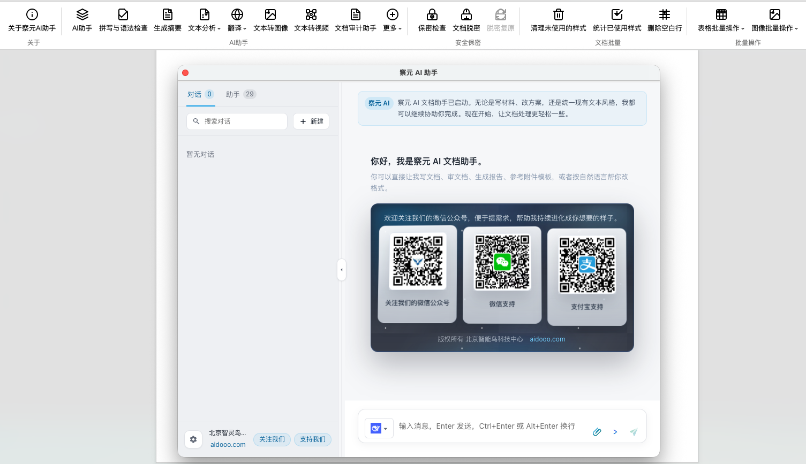 | WPS 文字端「察元AI助理」打开的 **AI 助手对话面板**（欢迎页） |
|  | **文本分析**下拉：换种方式重写 / 扩写 / 缩写 / AI 痕迹检查 / 提炼关键词等 |
| 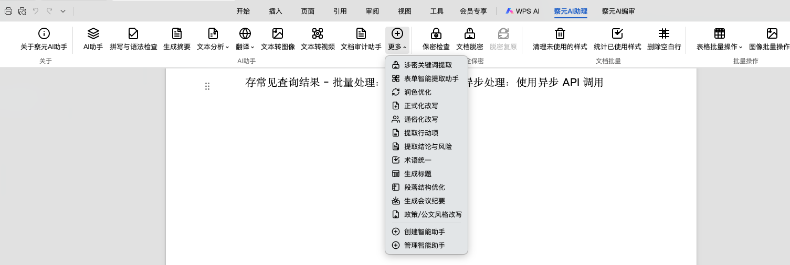 | **更多**菜单：涉密关键词提取 / 表单智能提取 / 润色优化 / 生成会议纪要 / 创建·管理智能助手 |
|  | **察元AI编审**选项卡：表单辅助 / 模板管理 / 规则管理 / 察元设置 |
| 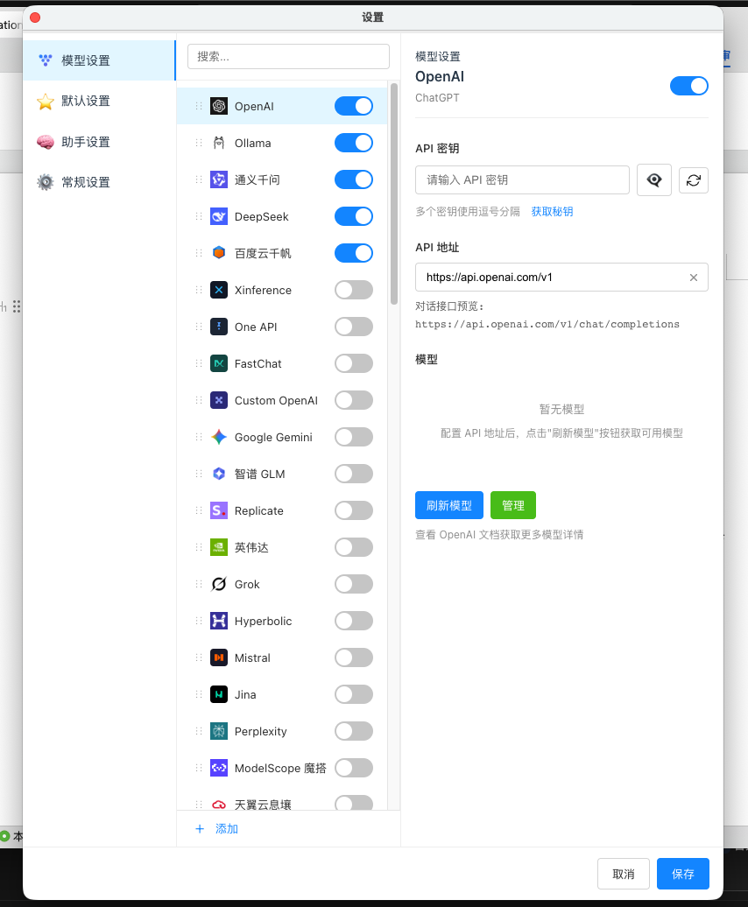 | 设置 → 模型设置：OpenAI / Ollama / 通义千问 / DeepSeek 等**供应商与密钥管理** |
| 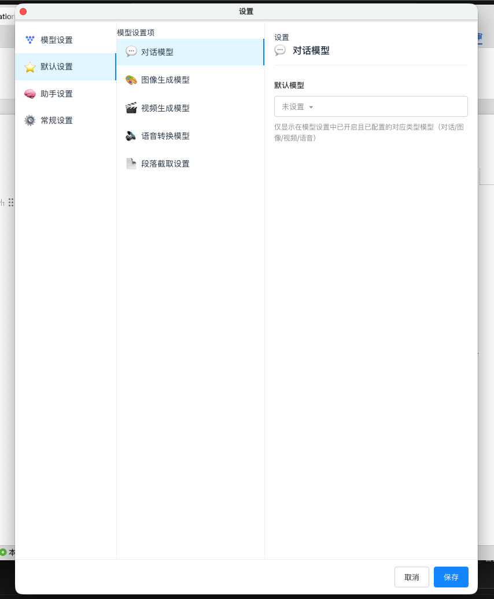 | 设置 → 默认设置：按用途（对话 / 生图 / 生视频 / 语音 / 截取）指定**默认模型** |
| 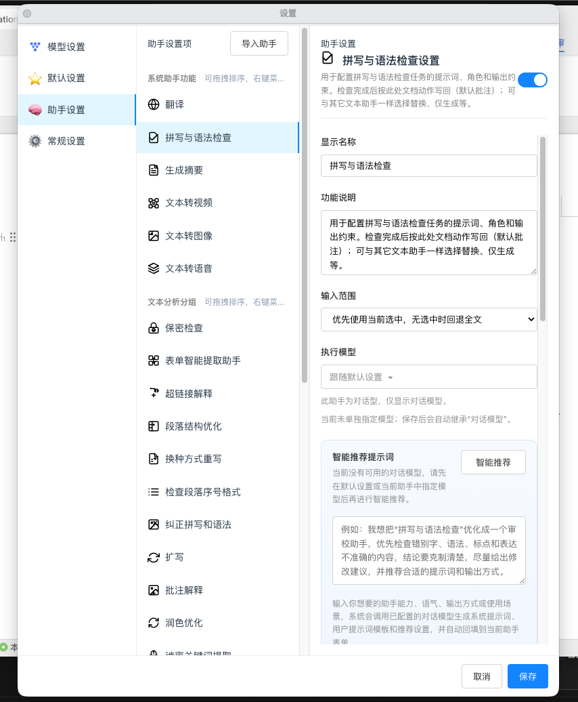 | 设置 → 助手设置：**助手提示词 / 输入范围 / 执行模型**配置 |
|  | 设置 → 知识库设置：**知识库连接列表**与可访问知识库 |
| 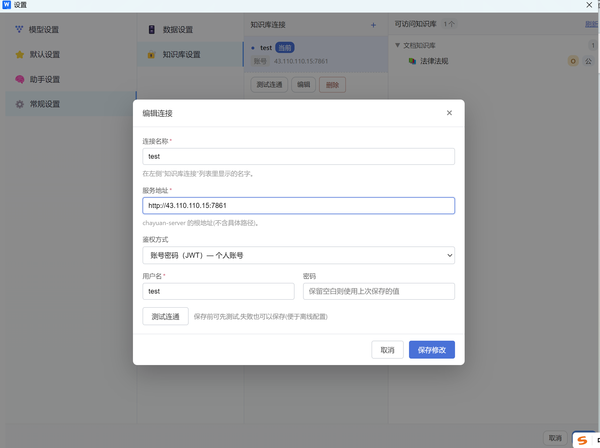 | **编辑知识库连接**：服务地址、JWT / HMAC 鉴权、连通测试 |

### 察元 AI 生态 Web 工作台（桌面版 / 网络版）

| 截图 | 说明 |
|:---:|---|
| 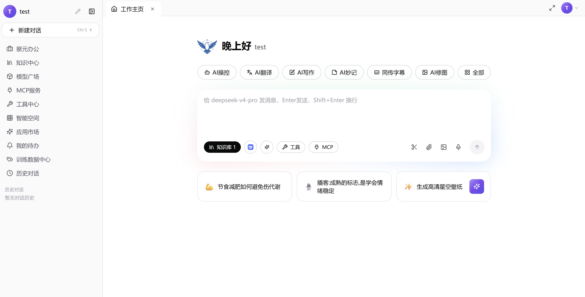 | 察元办公 Web 工作台**主页**（AI 操控 / AI 翻译 / AI 写作快捷入口） |
|  | Web 端**新对话**（知识库 / 工具 / MCP 输入入口） |
|  | **多模型并排对比**对话 |
| 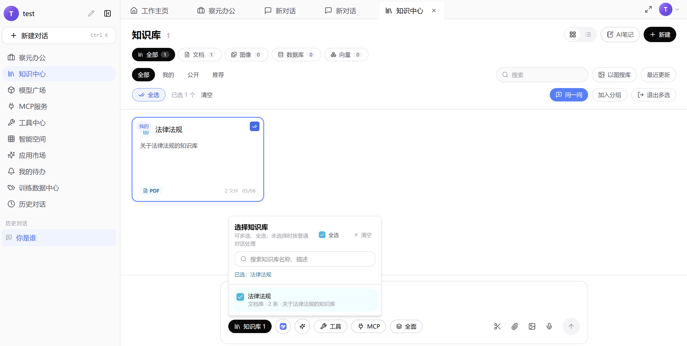 | 知识中心：**选择知识库** |
| 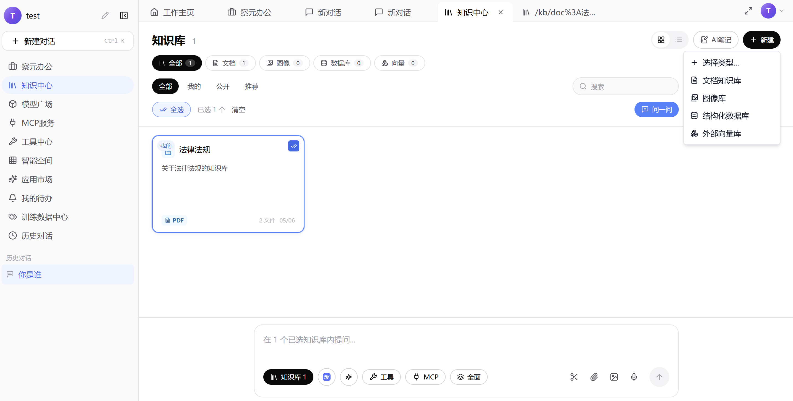 | 新建：文档知识库 / 图像库 / 结构化数据库 / 外部向量库 |
| 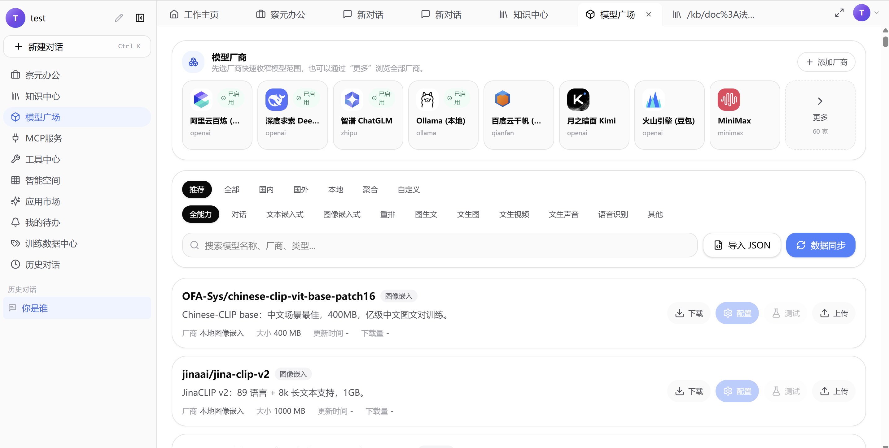 | **模型广场**：厂商卡片与模型下载 / 配置 / 测试 |
| 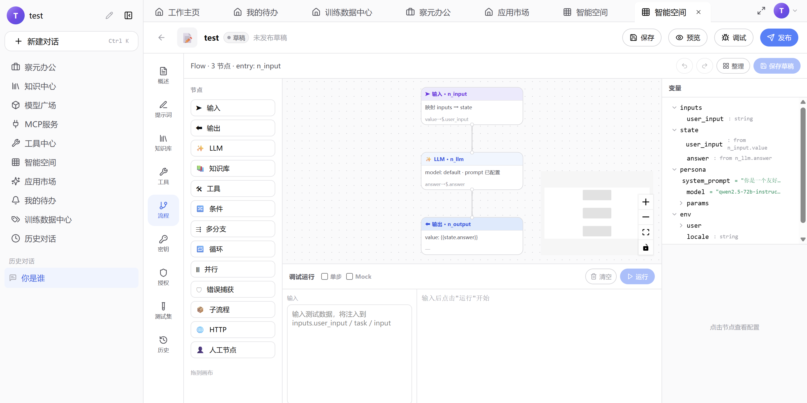 | 智能空间 **Flow 流程编排画布** |
| 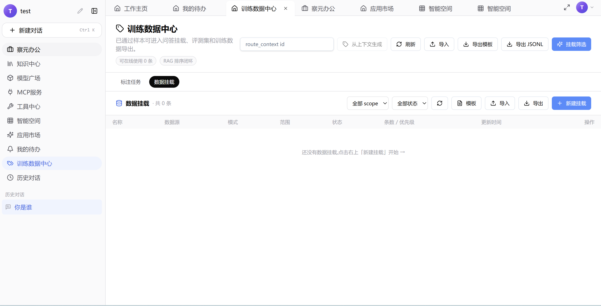 | **训练数据中心**：数据挂载 |

> 截图与当前安装版本可能存在细微差异，以运行中软件为准。应用内「关于」页另内置历史预览图（`public/images/about/`）随包分发。

---

## 四、安装与快速上手

### 4.1 三平台安装包（推荐，无需 Node.js）

| 平台 | 安装包 | 说明 |
|---|---|---|
| Windows | `chayuan-<版本>-windows-x64.exe` | 自解压安装器；sidecar 为 GUI 子系统，双击直启不弹黑窗 |
| macOS | `chayuan-<版本>-macos-<arch>.pkg` | 支持 arm64 / x86_64；含容器修复脚本 `scripts/repair-mac-jsaddons-container.sh` |
| Linux | `chayuan-<版本>-linux-<arch>.deb` | deb 安装；postinst 完成多注册源治理，三端面板即装即用 |

**下载渠道：** 官网 [https://aidooo.com](https://aidooo.com) · [GitHub Releases](https://github.com/zhgyuhuii/chayuan-wps-releases/releases) · [百度网盘](https://pan.baidu.com/s/5kGNUqSLs7-6g8RNh5FsBcA)

安装器自动完成：释放加载项到 jsaddons 目录 + 写 `publish.xml` → 释放 `chayuan-mcp` 二进制并**注册开机自启**（Windows `HKCU\Run` / macOS LaunchAgent `com.chayuan.mcp` / Linux systemd --user）→ 四级体检（jsaddons → `/healthz` → MCP `initialize` 握手 → 桥接工具）。装前自动停旧 agent 服务并清理 62588 端口占用，杜绝「装完还是旧版」。

**上手三步：** ① 安装并打开 WPS → ② 功能区出现「察元AI助理」选项卡，点「AI助手」→ ③ 在设置中配模型（或直接用本地 Ollama），开始对话。

### 4.2 从源码运行（开发者）

```bash
npm install
npm run dev            # vite 开发服务，http://localhost:3890
npm run build
npm run build:wps      # WPS 加载项打包
```

三宿主（文字/表格/演示）联调请勿使用 `wpsjs debug`（它只注册单宿主）：

```bash
npm run dev:debug                # 起 vite + 写三宿主调试注册 + 拉起 WPS
npm run dev:debug -- --restore   # 结束调试，还原正式 publish.xml
```

> 首次在表格/演示宿主加载时 WPS 可能弹「信任加载项」确认（authaddin.json 按宿主分记），选信任即可。

---

## 五、本机 MCP 文档智能体（面向外部 AI 智能体）

察元内置一个**本机 MCP（Model Context Protocol）文档智能体服务**：把 WPS 文档的读取、定位、替换、批注、校对、知识库检索、表格与演示操作、模板生成、文件解析等能力暴露为标准 **Streamable HTTP MCP** 接口。任何支持 MCP 的 AI 智能体——**Claude Code、OpenAI Codex、Cursor、Cline、Hermes、OpenClaw** 等——只要填一个 URL，就能**直接在你的 WPS 文档里干活**：打开文档、读取正文、圈错别字写批注、批量替换、按口语「在哪插」插入表格行列 / 合并单元格、多文档交叉校对、按模板生成整套新文档。

- **无需鉴权**：仅监听 `127.0.0.1:62588`，本机即信任边界；连接只用一个 URL，无需 Token / 命令行 / stdio。
- **完全离线**：sidecar 与 WPS 同机，文档与密钥不出域，适配离线 / 内网 / 政企部署。
- **随安装自启**：安装包自动注册开机自启，**无需 Node.js**（5 平台单文件二进制）。
- **写确认纪律**：所有写操作「预览 → 确认（`confirmed:true`）→ 落盘」，每次确认写记审计 `audit.jsonl`。

### 5.1 一行接入（所有 MCP 客户端通用）

服务地址：`http://127.0.0.1:62588/mcp` · 健康检查：`GET http://127.0.0.1:62588/healthz`（应返回 `online`）

**Claude Code：**

```bash
claude mcp add --transport http chayuan-wps-mcp http://127.0.0.1:62588/mcp
```

或写入项目级 / 用户级 `.mcp.json`：

```json
{
  "mcpServers": {
    "chayuan-wps-mcp": { "url": "http://127.0.0.1:62588/mcp" }
  }
}
```

**OpenAI Codex（`~/.codex/config.toml`）：**

```toml
[mcp_servers.chayuan-wps-mcp]
url = "http://127.0.0.1:62588/mcp"
```

**Cursor（`.cursor/mcp.json` 或 设置 → MCP → Add）：**

```json
{
  "mcpServers": {
    "chayuan-wps-mcp": { "url": "http://127.0.0.1:62588/mcp" }
  }
}
```

**Cline / Hermes / OpenClaw / Claude Desktop 等其它客户端：** 新建 MCP 服务，类型选 **HTTP / Streamable HTTP**，URL 填 `http://127.0.0.1:62588/mcp`，无需 Token、无需 stdio。

**MCP Inspector 手动验证：**

```bash
npx @modelcontextprotocol/inspector
# 选择 Streamable HTTP，填 http://127.0.0.1:62588/mcp，点 Connect
```

> **排错**：连不上时确认 WPS 已打开、察元加载项已加载（`/healthz` 返回 `online`）。远程机器需经本机代理或设 `CHAYUAN_MCP_PORT`。完整连接说明见 [docs/mcp-connection.md](docs/mcp-connection.md)，工具面权威清单见 [docs/user-tutorials/W39-MCP工具面总览.md](docs/user-tutorials/W39-MCP工具面总览.md)。

### 5.2 工具面总览（sidecar v0.13.0）

**工具规模**：内部定义 **69 个工具**，`tools/list` 对外实见 **53 个**（17 个细粒度工具聚合为域工具，33 个旧名保持别名兼容，可调用名合计 86 个）。

| 分组 | 工具 | 说明 |
|---|---|---|
| 主机与健康 | `wps_status` `wps_launch` | 分层健康（sidecar/Agent/三宿主/活动文档）；冷启动 WPS 并等待加载项连上 |
| 文档生命周期 | `document_open` `document_ensure_open` `document_list_open` `document_activate` `document_meta` `document_save` | 打开 / 确保打开 / 列出已开 / 切换 / 元信息 / 保存另存 |
| 读取与定位 | `document_list_paragraphs` `document_chunks` `document_get_text` `document_locate` | 逐段列表带锚点、长文分块翻页、全文/选区文本、定位字词多命中 |
| 写回 | `document_replace` `document_insert` `document_apply_ops` | 替换锚点段、相对锚点插入、**批量写回 ≤200 ops**（replace/comment/comment-replace/insert-after） |
| 格式样式 | `format_read` `format_run` `format_para` `format_apply_ops` `system_fonts_list` | 读格式、文字级/段落级格式、批量格式写回、系统字体 |
| 校对 | `proofread_run` `proofread_apply_comments` `proofread_job_poll` | dryRun 问题清单 → 写成 WPS 批注（需 confirmed）→ 异步任务轮询 |
| 域聚合（17 个） | `comment` `revision` `layout` `nav` `toc` `bookmark` `table` `caption` `field` `image` `hyperlink` `headerfooter` `watermark` `style` `export` `spreadsheet` `presentation` | 每个工具带 action 子操作；`table` 12 动作（切片读+插行列+合并单元格+列宽+导出）；`spreadsheet`（ET 宿主）23 动作（读 6 写 17，含加密/解密另存、图表）；`presentation`（WPP 宿主）23 动作（读 4 写 19，含逐页生成、整页配图、演讲备注、放映、导出） |
| 脱密 | `declassify_status` `declassify_preview` `declassify_apply` `declassify_restore` | 预览不落盘 → 确认应用（密码+关键词）→ 凭密码复原；仅本机可信通道 |
| 知识库与助手 | `kb_retrieve` `assistants_list_domains` `assistants_search` `assistants_get` | 检索知识库片段；4526 个领域助手目录 / 检索 / 导出完整定义 |
| 生图与素材 | `image_search` `generate_image` | 网络搜图存本地；按已配置生图模型生成（PPT 宿主自动 16:9） |
| 模板与文件 | `template_generate` `file_parse` | 按模板 pptx/docx/xlsx + 素材后台生成整套新文档并自动打开（多轮核对）；本地文件解析为模型可读文本（docx/xlsx/pptx/pdf/eml/zip 等） |
| 内部 | `chat_turn` | 助手面板内部对话回合（非对外） |

配套：**Resources**（`chayuan://wps/health`、`chayuan://guide/*`、`chayuan://assistants/*`）· **Prompts**（`para_translate_insert_after` 逐段翻译插段后、`open_local_document`）· **错误码**（`WPS_AGENT_OFFLINE` / `DOCUMENT_TOO_LARGE` / `LOCATE_MISMATCH` / `LICENSE_REQUIRED` / `MODEL_NOT_CONFIGURED` / `CONFIRMATION_REQUIRED`）。

### 5.3 使用场景与提示词（穷举，可直接复制改写）

对接 Claude Code / Codex / Cursor 等客户端后，直接对当前打开的 WPS 文档说下面这类话即可。默认建议：**先预览 / dryRun，再确认写批注或改正文**；涉密、定稿类务必人工复核。

#### ① 错别字 · 别字 · 同音字

| 场景 | 示例提示词 |
|------|------------|
| 全文错别字 | 帮我检查文档中的错别字，用批注标出原文和建议改法 |
| 选区错别字 | 只检查当前选区的错别字，写成批注 |
| 表格内错别字 | 重点检查表格单元格里的错别字，批注必须钉在具体错字上 |
| 同音别字 | 排查同音别字（如「的/地/得」「象/像」「做/作」），批注说明理由 |
| 形近字 | 检查形近字误用（如「己/已/巳」「戊/戌/戍」） |
| 专有名词 | 核对文中人名、地名、单位名是否前后一致，不一致处批注 |
| 成语典故 | 检查成语是否写错或误用（如「再接再厉」「有的放矢」），批注纠正 |
| 先预览后写回 | 先跑一遍校对（dryRun），汇总问题列表，不要先改正文；我确认后再写成批注 |
| 直接改正 | 找出错别字并直接改正正文（先给我预览清单，确认后再执行） |
| 多文档校对 | 打开目录下这几份文档，交叉检查错别字与术语是否一致 |

#### ② 标点符号 · 空格 · 编号

| 场景 | 示例提示词 |
|------|------------|
| 标点检查 | 帮我检查标点符号是否正确（中英文标点混用、书名号、引号配对等），用批注标出 |
| 中英文标点 | 把误用的英文逗号/句号改成中文标点（或按公文规范反过来），先预览 |
| 引号书名号 | 检查引号、书名号、括号是否配对完整 |
| 顿号逗号 | 检查并列成分用顿号还是逗号是否得当 |
| 省略号破折号 | 规范省略号、破折号写法 |
| 数字与单位 | 检查数字与单位之间空格、百分号、温度符号等是否规范 |
| 多余空格 | 清除中文之间的多余空格，保留英文单词间空格 |
| 序号体例 | 检查标题/条款序号（一、（一）、1.）是否层级混乱，批注指出 |
| 列表标点 | 检查条目末尾句号/分号是否统一 |

#### ③ 语法 · 病句 · 表达

| 场景 | 示例提示词 |
|------|------------|
| 病句 | 帮我检查病句、成分残缺、搭配不当，用批注给出改法 |
| 主谓宾 | 检查主谓不一致、动宾搭配错误 |
| 冗余重复 | 标出语句冗余、同义反复，建议删改 |
| 歧义句 | 找出有歧义的句子并给出两种改写 |
| 口语书面语 | 把过于口语的表述改成书面语（或反过来），用批注对比 |
| 被动句 | 检查滥用被动或「被」字句别扭处 |
| 长句拆分 | 过长难句请建议拆分，批注给出拆法 |
| 衔接过渡 | 检查段落衔接是否生硬，建议过渡句 |

#### ④ 正确性 · 逻辑 · 事实核对

| 场景 | 示例提示词 |
|------|------------|
| 正确性总检 | 帮我核对这篇文章的正确性：错别字、标点、语法、前后矛盾一并查，结果用批注 |
| 前后矛盾 | 检查文中数据、时间、称谓是否前后矛盾 |
| 逻辑漏洞 | 检查论证是否跳跃、结论是否缺少前提，批注说明 |
| 数字勾稽 | 核对数表与正文数字是否一致（合计、百分比） |
| 时间线 | 检查日期、工期、里程碑是否时间线合理 |
| 引用出处 | 检查「据悉/据说」类表述是否缺出处，提醒补全 |
| 单位换算 | 检查单位换算、数量级是否明显错误 |
| 图表一致 | 核对正文描述与表格内容是否一致 |
| 版本口径 | 对照上一版/附件，标出口径变化处（打开两份文档对比） |

#### ⑤ 公文 · 合同 · 规范体例

| 场景 | 示例提示词 |
|------|------------|
| 公文格式 | 按党政机关公文习惯检查标题、主送、落款、附件说明是否缺项 |
| 敬辞谦辞 | 检查称谓、敬辞是否得体 |
| 合同条款 | 检查合同关键条款是否缺主体、金额、期限、违约责任，列风险清单批注 |
| 敏感措辞 | 标出绝对化用语（「务必」「从未」「100%」）并建议弱化 |
| 密级标识 | 检查是否出现密级/保密期限标识不当（仅提示，不做定密） |
| 落款日期 | 检查成文日期、签发人是否齐全 |
| 附件引用 | 正文提到的附件是否都有对应附件标题 |

#### ⑥ 翻译 · 中英转换

| 场景 | 示例提示词 |
|------|------------|
| 英译插段后 | 帮我翻译成英文，并把译文插到每一段后面 |
| 中译插段后 | 把英文段落译成中文，插到各段后面 |
| 仅译文批注 | 给出译文建议，用批注写在原段，不要改正文 |
| 术语统一 | 翻译时统一专业术语，先列出术语表再开译 |
| 保留格式 | 翻译时保留标题层级与表格结构 |
| 选区翻译 | 只翻译当前选区 |

#### ⑦ 润色 · 改写 · 摘要 · 扩写

| 场景 | 示例提示词 |
|------|------------|
| 润色 | 在不改变原意的前提下润色全文，改动处用批注说明 |
| 更正式 | 改得更正式、更适合上报材料 |
| 更简洁 | 压缩水分，删空话套话，给出删改批注 |
| 摘要 | 生成 300 字以内摘要，插入文档开头（先预览） |
| 要点列表 | 提炼十条要点，插到文首 |
| 扩写 | 把第 3 段扩写得更具体，保留原论点 |
| 改语气 | 改成更委婉/更强硬的语气（指定一种） |
| 去 AI 腔 | 弱化「首先其次总之」等模板腔，批注修改建议 |

#### ⑧ 定位 · 替换 · 批量写回

| 场景 | 示例提示词 |
|------|------------|
| 查找定位 | 找出文中所有「永鹅」出现位置 |
| 批量替换 | 把「永鹅」全部替换为「咏鹅」，先预览再确认 |
| 条件替换 | 仅在表格第二列把 A 替换为 B |
| 插入段后 | 在每一段后面插入一行「【已审】」标记（先预览） |
| 批注解释 | 给所有「待确认」字样加上批注「请业务确认」 |
| 按清单改正 | 按我给你的问题清单，逐条定位并写成批注/替换 |

#### ⑨ 表格 · 名单 · 名录

| 场景 | 示例提示词 |
|------|------------|
| 表内校对 | 检查表格内文字的错别字与标点，批注钉在单元格文字上 |
| 空单元格 | 标出不应为空的空单元格 |
| 列对齐语义 | 检查同一列单位/格式是否一致 |
| 名单去重 | 检查人员名单是否重名、漏项 |
| 表转叙述 | 把第一张表概括成一段说明文字插入表前 |

#### ⑩ 保密 · 脱密 · 敏感信息（辅助，非定密）

| 场景 | 示例提示词 |
|------|------------|
| 保密风险 | 帮我检查这份材料的保密风险与敏感信息，用批注标出 |
| 身份证手机号 | 查找疑似身份证号、手机号、银行卡号并批注 |
| 脱密预览 | 按关键词做脱密预览，先不要落盘 |
| 脱密应用 | 确认后应用脱密（按流程要密码与确认） |
| 复原 | 用密码复原脱密文档 |
| 外发前检查 | 外发前再扫一遍是否残留内部路径、账号、未脱敏字段 |

#### ⑪ 知识库 · 制度对照（需已配置 KB）

| 场景 | 示例提示词 |
|------|------------|
| 对照制度 | 对照知识库里的制度，检查本文是否违规表述，引用条文批注 |
| 补全依据 | 给结论句补充可引用的制度依据 |
| 术语标准名 | 用知识库标准术语统一文中叫法 |

#### ⑫ 多文档 · 打开 · 保存

| 场景 | 示例提示词 |
|------|------------|
| 打开文档 | 打开桌面上的「成语整理表格.docx」 |
| 确保打开 | 确保当前就是这份路径的文档，不是则打开它 |
| 另存 | 校对完成后另存为「xxx-已校对.docx」 |
| 多文件串行 | 依次处理这两个文件：先错别字批注，再统一术语 |
| 新建草稿 | 新建空白文档，写入会议纪要提纲 |

#### ⑬ 组合拳（推荐工作流提示词，可整段复制）

```text
你是 WPS 文档校对助手，通过 chayuan-wps-mcp 操作当前文档：
1）先 proofread dryRun，检查错别字、标点、明显病句；
2）汇总问题列表给我确认；
3）我回复「确认写批注」后，再写成 WPS 批注（钉在具体文字上，尤其是表格）；
4）不要擅自改正文，除非我明确说「确认替换」。
```

```text
帮我做发布前终检：错别字、标点、数字前后一致性、表格与正文是否一致；
全部用批注输出；最后给我一份问题分级摘要（严重/一般/建议）。
```

```text
把全文译成英文：每一段中文后插入对应英文译文；术语先统一；
插入前先预览第一段样例，我确认风格后再全部执行。
```

```text
用我桌面上的「公司模板.pptx」和附件里的产品资料，生成一份 10 页的产品介绍 PPT，
保留模板的母版和配色；生成前先给我大纲确认。
```

> 加载项内也可直接用「拼写与语法检查 / 智能批注 / 自定义助手」完成同类任务，无需外部 Agent。

---

## 六、wps-skill-chayuan 技能包：一条命令，三件事就绪

`wps-skill-chayuan` 是察元的**便携技能包**：一份技能定义（`SKILL.md`）+ 一条 4 步闭环安装脚本，让 **Claude Code / Cursor / OpenAI Codex** 开箱即用察元的 53 个文档工具。**跑一次脚本，三件事同时就绪**——WPS 加载项、MCP 自启服务、AI 客户端技能文件。

> 📖 从安装到使用的完整图文指南：见 [`docs/wps-skill-chayuan-guide.md`](docs/wps-skill-chayuan-guide.md)。

### 双向自启：从哪端装都行

| 从哪开始 | 跑安装脚本后得到 |
| --- | --- |
| **装技能**（想给 AI 客户端接 WPS） | ✅ 技能文件投放进 Claude/Cursor/Codex　＋　✅ WPS 加载项自动安装　＋　✅ MCP 开机自启 |
| **装加载项**（WPS 里装了察元） | ✅ 加载项就位　＋　✅ MCP 开机自启　＋　✅ 一键把技能投放到本机 AI 客户端 |

**装技能 = 装加载项，装加载项 = 带技能。** 两种入口殊途同归：跑完一次脚本，**WPS 加载项 + MCP 自启服务 + AI 客户端技能**三者全部到位。

### 一行命令安装（终端用户，无需克隆仓库）

**Windows（PowerShell）：**

```powershell
& {[Net.ServicePointManager]::SecurityProtocol=[Net.SecurityProtocolType]::Tls12;$w=New-Object Net.WebClient;$w.Encoding=[Text.Encoding]::UTF8;$s=$w.DownloadString('https://gitee.com/cloudshd/chayuan-wps-releases/raw/master/scripts/install-wps-skill-chayuan.ps1');if($s.Length -and $s[0]-eq[char]0xFEFF){$s=$s.Substring(1)};& ([scriptblock]::Create($s)) -Fetch}
```

> 为什么不直接 `iwr | iex`？Windows PowerShell 5.1 默认按 GBK 解码 `iwr` 返回体，会因 UTF-8+BOM 首字节乱码报错。这里用 `WebClient` + 显式 UTF-8 解码（去 BOM）再建 scriptblock，既绕过执行策略、又不会乱码。

**macOS / Linux：**

```bash
curl -fsSL https://gitee.com/cloudshd/chayuan-wps-releases/raw/master/scripts/install-wps-skill-chayuan.sh | bash -s -- --fetch
```

> 海外 / GitHub 直连：把 URL 换成 `https://raw.githubusercontent.com/zhgyuhuii/chayuan/main/scripts/install-wps-skill-chayuan.{ps1,sh}`。脚本自动多源回退下载便携包（Gitee → aidooo → GitHub，**sha256 强校验**）→ 装加载项 + MCP 自启 + 投放技能到 Claude/Cursor/Codex。

**已克隆本仓库** 也可直接跑本地脚本（等价）：

```powershell
powershell -ExecutionPolicy Bypass -File scripts\install-wps-skill-chayuan.ps1 -Fetch
```
```bash
bash scripts/install-wps-skill-chayuan.sh --fetch
```

`-SkillOnly` 只投放技能文件，不动加载项 / 服务；`-Version 6.1.2` 可指定版本。

### 脚本干的四步（同一个脚本）

1. **装加载项**——释放到 jsaddons 目录 + 写 `publish.xml`，WPS 打开即加载察元。
2. **MCP 自启**——释放 `chayuan-mcp` 二进制 + 注册开机自启（Win `HKCU\Run` / macOS LaunchAgent / Linux systemd --user），**无需 Node.js**。
3. **四级体检**——jsaddons → `/healthz` → `initialize` 握手 → 桥接工具，装完即验证可用。
4. **投放技能**——自动探测 Claude / Cursor / Codex，投放技能文件，AI 客户端立刻拥有察元技能。

---

## 七、察元 AI 生态：一套引擎，四档 SKU

**察元 AI 文档助手不是一个孤立插件。** 官网把整个察元 AI 概括为「**一套引擎，四档 SKU**」——同一套查询引擎（文档 / 结构化 / 向量 / 办公 / 图像五类知识源）+ 模型网关 + 本地能力，按场景换一种用法。**本加载项就是第一档「文档助手」**，负责把这套能力送进你正在写的 WPS 文档里。

| # | 形态（SKU） | 项目 / 入口 | 解决的用户心结 |
|---|---|---|---|
| 1 | **察元 AI 文档助手**（本项目） | [chayuan-wps](https://github.com/zhgyuhuii/chayuan-wps-releases)（WPS 加载项） | "AI 别让我在浏览器和文档之间反复横跳——就在我正写的这页公文 / 合同里帮我改、帮我查、帮我写回。" |
| 2 | **察元 AI 桌面版** | [chayuan-desktop](https://github.com/zhgyuhuii/chayuan-desktop-releases)（单机安装包） | "装我自己电脑里、断网也能跑，密钥和文档一个字节都别出我这台机器。" |
| 3 | **察元 AI 服务版** | [chayuan-desktop](https://github.com/zhgyuhuii/chayuan-desktop-releases)（Docker 网络版） | "一次部署全科室共用，知识库集中沉淀，别再按人头 / 按调用量收费。" |
| 4 | **察元 AI 至臻版** | [chayuan-desktop](https://github.com/zhgyuhuii/chayuan-desktop-releases)（Docker 网络版 + 在线办公） | "数百到上万人，打开浏览器每人一个工作空间，管得住、审得清。" |

**本加载项与桌面版 / 网络版如何协作：**

```
        ┌──────────────────────────────────────────────┐
        │  察元 AI 文档助手 (本项目, WPS 加载项)        │
        │  • 运行在 WPS 文字/表格/演示内:窗格 + Ribbon  │
        │  • 选区 / 全文上下文感知                       │
        │  • 写回:插入 / 替换 / 批注 / 链接批注 / 追加  │
        └───────────────────┬──────────────────────────┘
                            │  HTTP/REST · 在「服务器地址」里填:
                            │  • 单机版 → http://127.0.0.1:62581 (本机, 免登录)
                            │  • 网络版 → https://你们的部署地址 (团队, 带登录)
                            │  /api/v1/kb-query/search · /api/chat/completions
                            ▼
        ┌──────────────────────────────────────────────┐
        │  察元 AI 桌面版 / 网络版 (chayuan-desktop)    │
        │  • 同一份 chayuan-server 引擎                  │
        │  • 知识库 / 模型网关 / 工具 / 嵌入 / 重排     │
        │  • 单机:落用户目录;网络:多用户隔离          │
        └──────────────────────────────────────────────┘
```

- **同一份知识库，两处复用**：桌面版 / 网络版跑本机或团队的 sidecar 做嵌入、检索、重排；文档助手在「服务器地址」填一行端点就接上——写文章和对话都用同一份 KB，密钥和文档都不出域。
- **能独立用，也能组合用**：只用本加载项 + 你自己的 Ollama / 云端模型即可工作；接上桌面版 / 网络版后，额外获得五类知识源统一检索、引用气泡、原文一键下载等企业级能力。

> 桌面版 / 网络版完整说明见 chayuan-desktop 仓库 README 及其 `docker/README.md`（网络版一键部署）。生态 Web 工作台界面预览见上文[截图区](#三界面截图)。

---

## 八、版本历史

**当前版本：`6.1.2`**（2026-10-28）· MCP 目录版本 `0.13.0`

### v6.1.2 — 附件解析全链路修复与安装器加固

- **MCP 文档智能体管线补齐附件上下文**：对话说「附件1里有什么」直接可答——系统提示注入本轮上传附件（含已提取正文），本地循环 / 跨窗口派发 / chatTurnRunner 三条路径全贯通。
- **任务超时对齐**：大 PDF 解析、旧版 doc/ppt 转换不再被默认超时误杀；脱密看门狗放宽；写锁按 lockId 精确放锁。
- **安装器装前自动停旧服务**：`launchctl bootout` → `pkill` 四种进程模式 → lsof 强杀 62588 端口占用并等释放；杜绝「装完还是旧版」。
- **容器假成功不再无声**：macOS 沙盒版 WPS 容器写入失败时安装日志响亮警告 + 修复指引；新增 `scripts/repair-mac-jsaddons-container.sh`（status / 修复 / 回滚三模式）。
- **Linux deb 升级治理**：postinst 补齐 WPS 多注册源治理，根治升级后三端面板白屏。

### v6.1.0 — 模板编制全面升级

- 首页对话直接用你的模板文件（.pptx / .docx / .xlsx）出整套文档：按模板类型自动路由宿主，目标宿主离线自动拉起。
- 形状级剖析与内容映射：逐页剖析形状角色与字号字体坐标，按模板版面对位落内容；隐形水印保持原样；新内容继承模板中文字体。
- 打开前多轮核对：机器审计（占位残留 / 溢出 / 字体一致性）+ 自愈闭环 + AI 多维审查，默认 3 轮（上限 4），逐维展示 ✓ / ✗。
- 交付保留模板设计：字节级拷贝再填内容，母版 / 背景 / 字体原样保留；生成完对话自动跟到新文档窗格。

### v6.0.0 — 三端 AI 工作台

- **表格助手**（66 配方 + 六大主按钮 + 文档安全）与**演示助手**（81 配方 + AI 生成 PPT + 整套工具）上线，三端共享同一智能体内核。
- **三级生图 + 网络资源搜索**：模型生图 → 网络搜图 → SVG 降级；Serper / Tavily / Pexels 等九类搜索源可配。
- **file_parse 文件解析**：1-8 路径或附件别名，全格式矩阵 + token 预算三档。
- **本机知识库自动发现**（端口 52582）+ **多文档会话隔离** + 三宿主停靠统一。

### v5.x — 内嵌智能体 · 接入智能体 · 停靠双形态

- **内嵌智能体**：对话窗内置完整智能体循环（规划 / 工具调用 / 跨回合记忆 / 任务清单），不只问答，能直接写回文档。
- **写回安全**：文档写锁 + FIFO 排队 + OCC 写前校验；写前快照一键撤销；权限三档；sidecar 最小 token 鉴权 + 调用方审计。
- **MCP 服务加固**：服务未就绪三级分诊、全链自愈、真机四大崩溃定案根治；打包自动重编 sidecar 二进制。
- **停靠双形态**：浮窗 / 左右停靠一键切换，停靠面板宽 = 屏幕一半。
- **本地引擎一键安装**：Ollama / LM Studio 检测引导；在线客服嵌入；官网升级提醒。

### 更早版本

[v6.0.0 完整发布说明](RELEASE_NOTES_v6.0.0.md) · [v5.x→v4.1（表格结构写回 · 技能双向自启）](RELEASE_NOTES_v4.1.md) · [v4.0.0（本机 MCP 文档智能体）](RELEASE_NOTES_v4.0.md) · [v3.0（远程知识库 RAG）](RELEASE_NOTES_v3.0.md) · [CHANGELOG.auto.md](CHANGELOG.auto.md)

---

## 九、模型与供应商

实际可用模型取决于**设置**中的 API 密钥、基础 URL 与供应商配置。**纯离线场景可仅启用本机或内网 OpenAI 兼容服务**，密钥全部本地保存。

| 类别 | 代表 |
|---|---|
| 本地 / 离线 | **Ollama**（11434）、**LM Studio**（1234）、**Xinference**（9997）、FastChat（8000）、任意 OpenAI 兼容内网网关（**OneAPI**、New API 等） |
| 云端（OpenAI 兼容） | OpenAI、**DeepSeek**、**阿里云百炼 / 通义千问 Qwen**、**智谱 GLM**、**Kimi（月之暗面）**、千帆、Gemini、其它兼容端点 |
| 图像 / 语音 / 视频 | 各供应商对应模态端点；生图支持百炼原生 / OpenAI 兼容双通道路由 |

- 供应商分组与默认模型清单维护于 `src/utils/defaultModelGroups.js`；图标与启用状态见 `src/utils/modelSettings.js`。
- 模型卡可填「上下文窗口(tokens)」，面板按窗口自动定 token 预算（min(窗口×25%, 32k)）；外部 MCP 客户端用 `budgetTokens` 自报。
- 敏感段用本地模型、公开段用云端模型的「分流」用法可行——责任边界建议在组织制度上明确。

---

## 十、与常见办公 AI 的定位对照

> 下表仅对各家产品的**常见公开形态**做归纳，便于选型对照；不构成对任何第三方的功能承诺或排名。计费、数据驻留与私有化能力以各厂商官方文档与合同为准。

| 对比项 | **察元 AI 文档助手**（本项目） | **WPS AI**（金山内置） | **Microsoft 365 Copilot** | **飞书 / 腾讯文档 / Notion AI** | **通用大模型网页 / App**（豆包、通义、Kimi 等） |
|--------|---|---|---|---|---|
| 产品形态 | 第三方 **WPS** 智能加载项，三端（文字/表格/演示），可自建分发 | WPS 套件原生能力，绑定会员体系 | M365 订阅内 Word 等 Copilot | 在线协作编辑器内 AI | 独立对话页，与本地文档无原生写回链路 |
| 离线 / 内网自有推理 | **优先支持**：Ollama / LM Studio / Xinference / OneAPI | 以金山官方政企方案为准 | 以微软官方企业方案为准 | 依赖各自云服务 | 依赖各厂商云 API |
| 用户自选多模型 / 网关 | ✅ 多家供应商 + OpenAI 兼容基础 URL | 由金山产品线定义 | 由微软租户策略定义 | 由各产品线定义 | 各家独立 |
| WPS 内**写回**（插入/替换/批注/链接批注） | ✅ 九种写回动作 | ✅（动作集合以 WPS 版本为准） | ❌（宿主为 Word） | ❌（宿主为在线文档） | 通常 ❌，依赖复制粘贴 |
| 开源可审计 | ✅ **Apache-2.0**，本仓库 | ❌ | ❌ | ❌ | ❌ |
| 外部智能体经 MCP 读写文档 | ✅ 127.0.0.1:62588，53 工具 | ❌ | ❌ | ❌ | ❌ |
| 典型适用 | 已用 WPS、要内网模型 / OpenAI 兼容网关 / 细粒度写回与编审闭环 | 已用 WPS、要零安装官方 AI | M365 组织 | 在线协作组织 | 通用对话与站外起草 |

**与 WPS AI 的关系**：察元是**独立第三方加载项**（本仓库），WPS AI 是金山办公产品内置能力；二者在账号、计费、模型来源、数据路径与功能清单上**相互独立**，可并存于同一份 WPS。

**察元的差异化一句话**：WPS 原生深度集成 + 离线优先 + 九种写回与批注锚定 + 编审表单一体化 + 本机 MCP 可被外部智能体驱动——「可控、可审、可离线」的政企向文档 AI。

---

## 十一、开发指南

### 环境要求

- **Node.js** 与 **npm**（建议当前 LTS）；构建 MCP 二进制需 **Bun**（`npm run mcp:build-binary`）。
- **WPS Office**（加载项宿主，Windows / macOS / Linux 均可调试）。
- 推荐 **wpsjs** 工具链用于调试发布。

### 常用命令

```bash
npm install
npm run dev              # 开发服务 http://localhost:3890
npm run build            # 前端构建
npm run preview
npm run build:wps        # WPS 加载项打包（--online / --offline / --debug 变体）
npm run lint && npm run format

# —— 三平台安装包（可在一台机器上交叉构建）——
npm run build:wps-all        # 前端构建 + 生成 release/install-staging（三平台共享）
npm run build:wps-exe        # Windows 自解压安装器 release/chayuan-<ver>-windows-x64.exe
npm run build:wps-pkg-macos  # macOS 安装包 release/chayuan-<ver>-macos-<arch>.pkg
npm run build:wps-deb        # Linux deb       release/chayuan-<ver>-linux-<arch>.deb

# —— 本机 MCP 文档智能体服务 ——
npm run mcp:sidecar          # 开发态 node server.mjs（127.0.0.1:62588）
npm run mcp:build-binary     # 交叉编译 5 平台单文件二进制（需 Bun）
npm run mcp:selftest         # 真机自测（:quick / :tools 变体）

# —— 自检 ——
npm run doctor               # 项目 doctor 检查（:quick 快速档）
npm run test:agent-loop      # 智能体循环 smoke
npm run test:write-lock      # 文档写锁 smoke
```

### 项目结构速览

| 路径 | 内容 |
|---|---|
| `src/` | Vue 3 前端（46 条路由：AI 助手面板、设置、编审、任务中心、控制台等） |
| `public/ribbon*.xml` | 三宿主 Ribbon 配置（文字 / 表格 / 演示） |
| `mcp-sidecar/` | 本机 MCP 服务（`server.mjs` + `lib/toolCatalog.mjs` 69 工具定义） |
| `docs/user-tutorials/` | **44 篇用户教程**（W01-W44，11 个域，P0-P2 分级），从安装到 MCP 全覆盖 |
| `docs/mcp-connection.md` | MCP 连接与排错 |
| `skill-chayuan/` | wps-skill-chayuan 便携技能包 |
| `scripts/` | 构建安装包 / 自检 / 修复脚本 |
| `screenshots/` | README 截图（自包含目录） |

---

## 十二、常见问题 FAQ

**Q1：察元 AI 和 WPS AI 是什么关系？需要卸载 WPS AI 吗？**
察元是**独立第三方开源加载项**，与金山官方 WPS AI 相互独立（账号、计费、模型、数据路径均不同），可并存，无需卸载任何一个。

**Q2：必须联网吗？数据会传到你们服务器吗？**
不必联网。**离线 / 内网优先**是产品设计底线：接 Ollama / LM Studio / Xinference 等**本地模型**即可完整使用对话与助手流程，密钥全部保存在本机；文档内容只发给**你自己配置的模型端点**。察元自身不设云端转发。

**Q3：支持哪些大模型？**
任何 **OpenAI 兼容**对话端点均可配置（DeepSeek、通义千问/Qwen、智谱 GLM、Kimi、OpenAI、Gemini、OneAPI/New API 网关等）；图像 / 语音 / 视频走对应模态端点；生图支持百炼原生与 OpenAI 兼容双通道。

**Q4：怎么让 Claude Code / Cursor / Codex 直接操作我的 WPS 文档？**
打开 WPS 与察元后，在客户端注册一个 MCP 服务即可：`claude mcp add --transport http chayuan-wps-mcp http://127.0.0.1:62588/mcp`（Cursor / Codex 配置见[第五章](#五本机-mcp-文档智能体面向外部-ai-智能体)）。之后可直接说「检查这份文档的错别字并写批注」。

**Q5：MCP 服务会不会有安全风险？**
服务仅监听 `127.0.0.1`（本机即信任边界），外部机器无法直连；所有写操作「预览 → 确认 → 落盘」，每次确认写记入 `audit.jsonl` 审计；脱密工具仅本机可信通道可用。企业内如需更强隔离，可设 `CHAYUAN_MCP_PORT` 并配合本机防火墙策略。

**Q6：AI 校对能直接改正文吗？会不会改坏文档？**
可以，但默认路径是「检查 → 预览问题清单 → 你确认 → 写批注或改正文」。写回有四重保险：写锁串行（不互相覆盖）、写前快照（可一键撤销）、OCC 写前校验（冲突显式提示）、权限三档（默认「变更前确认」）。首次使用建议先跑 dryRun。

**Q7：支持哪些 WPS 版本和操作系统？**
支持 Windows / macOS（含 Apple Silicon）/ Linux 的 WPS Office。三平台官方安装包见[第四章](#四安装与快速上手)；Linux 为 deb 包，macOS 为 pkg 包，Windows 为自解压 exe。

**Q8：「4526 个内置助手」是什么概念？**
文字端内置**领域助手清单**：覆盖 228 个行业领域的专业提示词模板（财务、党务、医疗、招标、政务…），在对话中经 `assistants_search` 直接命中并执行，也可在「助手管理」中检索、导出、二次定制。加上表格端 66 配方、演示端 81 配方，并支持**无限自定义助手**。

**Q9：旧版 .doc / .ppt / .et 文件能处理吗？**
能。`file_parse` 与跨宿主管线会把旧格式**自动经对应 WPS 宿主转新格式再解析**（副本操作，不碰原文件，宿主离线自动拉起）。

**Q10：免费吗？开源协议是什么？商用要授权吗？**
源代码按 **Apache License 2.0** 开源，可自由使用、修改、商用（详见[许可章节](#十三许可商标与品牌)）。部分进阶能力有**能力门禁**（本地验签激活 + 免费额度），企业 OEM / 白标 / 品牌调整需另行取得书面授权。

**Q11：批量校对几十份文档怎么做？**
两条路：① 加载项内多文档会话 + 任务清单串行处理；② 外部智能体经 MCP「打开目录下这几份文档，交叉检查错别字与术语」批量处理（`document_apply_ops` 单次最多 200 ops）。

**Q12：升级后功能没变 / 面板白屏怎么办？**
安装器已内置「装前停旧服务 + 端口清理」。若仍有残留：Windows 重跑安装包；macOS 执行 `bash scripts/repair-mac-jsaddons-container.sh`（容器实况检查 / 修复 / 回滚）；Linux 重跑 deb。升级后请**完全重启 WPS**。

**Q13：接口报 `CONFIRMATION_REQUIRED` / `WPS_AGENT_OFFLINE` 是什么意思？**
前者表示该写工具需要带 `confirmed:true` 才落盘（安全设计，先看 preview 再确认）；后者表示 WPS / 察元加载项未连上 sidecar——打开 WPS、确认加载项已加载（`GET /healthz` 返回 `online`）即可。

---

## 十三、许可、商标与品牌

### 版权声明与许可

**软件名称（著作权意义上的全称）：** 察元 AI 文档助手（英文名 **Chayuan AI Document Assistant**，npm 包名 **`chayuan`**）。

**开源许可：** 本仓库源代码依照 **[Apache License, Version 2.0](LICENSE)** 授权。在遵守该许可证全部条款（包括保留版权声明、NOTICE 文件、专利授权与责任限制等）的前提下，您可以自由地使用、修改、合并、发布再许可及**用于商业目的**（企业内部分发、集成到办公环境、托管或增值服务等）。若您与权利人另行签署了商业许可、OEM、独占或附加协议，则以**该等书面协议**为准。

**著作权与出品：** 产品由**北京智灵鸟科技中心**研发与运营。界面文案、默认提示词模板、图标与品牌素材受著作权及相关知识产权法保护。**官网：** [https://aidooo.com](https://aidooo.com) · **微信公众号：** 智灵鸟科技

**免责声明：** 本软件按「原样」提供；大模型生成内容可能存在不准确或不适用的情形，涉密、合规与法律判断应以人工与正式制度为准；保密检查、脱密、AI 痕迹检查等功能仅为**辅助参考**，不构成保密定密结论或司法鉴定。

### 「察元」品牌标识约定

在**面向最终用户的界面**中，「察元」及固定搭配称谓（察元 AI / 察元 AI 文档助手 / 察元 AI 编审 / 关于察元 / 添加到察元 AI 助手等）出现在 Ribbon 分组与按钮、右键菜单、对话框与关于页等位置，属于**产品来源与品牌标识**。**未经权利人书面授权，再分发或定制版本不得对上述界面中的「察元」固定文案进行替换、删减、遮挡或误导性改写**（例如改为其他商业名称却仍指向本软件）。此要求不限制 Apache 2.0 允许的源码修改；但若向第三方提供**可安装的、面向最终用户的构建产物**，须保留品牌标识的显著性，或事先取得书面授权。企业私有化部署、白标（white-label）、界面整体本地化的品牌调整，请通过官网商务渠道取得**单独授权条款**。

### 商业使用速查

| 情形 | 说明 |
|------|------|
| 组织内部使用、部署于内网 | Apache 2.0 下通常允许；注意密钥与数据合规 |
| 商业分发、集成到产品或服务 | Apache 2.0 允许，须履行许可证义务；**品牌标识**遵守上文约定 |
| 与权利人签署附加协议 | 以协议为准（技术支持、商标使用范围、责任划分等） |
| 第三方模型与服务 | 各云厂商 / API 提供商条款与计费独立，与本软件开源许可无关 |

---

## 十四、下载与社区

| 渠道 | 项目 | 地址 |
|---|---|---|
| 官网 | 下载 / 文档 / 商务 | <https://aidooo.com> |
| GitHub 主仓（本项目） | 察元 AI 文档助手 · WPS 三端加载项 | <https://github.com/zhgyuhuii/chayuan> |
| GitHub 发布镜像 | 安装包与便携技能包 Releases | <https://github.com/zhgyuhuii/chayuan-wps-releases> |
| Gitee 发布仓 | 国内安装脚本与便携包 | <https://gitee.com/cloudshd/chayuan-wps-releases> |
| 察元 AI 桌面版 / 网络版 | 单机 / Docker / 在线办公 | <https://github.com/zhgyuhuii/chayuan-desktop-releases> |
| 百度网盘 | 安装包下载 | <https://pan.baidu.com/s/5kGNUqSLs7-6g8RNh5FsBcA> |

- 公开技术问题欢迎到 GitHub Issue 讨论；商务合作 / 企业授权 / OEM 定制请走官网。
- 应用内侧栏「反馈及建议」直达官网在线客服（离线回落公众号二维码）。
- 自愿捐助与关注方式以官网及应用内说明为准。

<div align="center">

**察元 AI 文档助手** · Chayuan AI Document Assistant · Vue 3 + Vite · Apache-2.0 · 北京智灵鸟科技中心

</div>

---

<details>
<summary><strong>🔍 搜索关键词索引（展开查看）</strong></summary>

**中文：** 察元AI · 察元 · 智灵鸟 · aidooo · WPS 加载项 · WPS 插件 · WPS AI 助手 · WPS 智能体 · WPS 文档智能体 · WPS 文字 AI · WPS 表格 AI · WPS 演示 AI · PPT AI · Excel AI · Word AI · jsaddons · wps-js-addon · AI 办公 · 办公自动化 · 智能办公 · 文档 AI · 文档智能体 · AI 写作 · AI 写作助手 · 写作辅助 · 公文写作 · 公文校对 · 公文格式检查 · 政务 AI · 政企 AI · 国企 AI · 体制内 AI 写作 · 涉密文档 · 保密检查 · 脱密 · 脱敏 · 敏感信息检查 · AI 痕迹检测 · 错别字检查 · 错别字校对 · 拼写检查 · 语法检查 · 病句检查 · 标点检查 · 多文档校对 · 批量校对 · 批量替换 · 批量修正 · 智能批注 · 自动批注 · 文档批注 · 校对软件 · 审校工具 · 润色 · 改写 · 扩写 · 缩写 · 摘要 · 自动摘要 · 会议纪要 · 纪要生成 · 翻译 · 多语种翻译 · 中英翻译 · 术语统一 · AI 翻译 · 生成 PPT · AI 生成 PPT · 一句话生成 PPT · PPT 大纲 · 演讲备注 · 口播稿 · 表格助手 · 公式助手 · VLOOKUP · SUMIF · 数据清洗 · 数据洞察 · 数据分析 · 一键图表 · 战报表 · 报表结论 · 一键美化 · 智能分列 · 按列拆表 · 文档抽取成表 · 模板编制 · 模板生成 · 从模板生成 PPT · 从模板生成 Word · 套红模板 · 表单填报 · 表单提取 · 字段提取 · 书签 · 文档审计 · 审计报告 · 知识库 · 知识库问答 · RAG · 检索增强 · 向量检索 · 本地知识库 · 企业知识库 · 制度对照 · 本地大模型 · 本地模型 · 离线大模型 · 离线 AI · 内网大模型 · 私有化部署 · 数据不出域 · Ollama · LM Studio · Xinference · OneAPI · New API · DeepSeek · 通义千问 · Qwen · 千问 · 智谱 · GLM · ChatGLM · Kimi · 月之暗面 · 百炼 · OpenAI 兼容 · 大模型网关 · MCP · MCP 服务器 · MCP Server · Model Context Protocol · Streamable HTTP · Claude Code · Claude · OpenAI Codex · Codex CLI · Cursor · Cline · Hermes · OpenClaw · 智能体 · AI Agent · Agent 工具 · 文生图 · AI 绘图 · 文生视频 · 语音合成 · TTS · 三级生图 · 网络搜图 · Serper · Tavily · Pexels · 任务编排 · 工作流 · 任务清单 · 任务中心 · 多会话 · 停靠面板 · 任务窗格 · 功能区 · Ribbon · 右键菜单 · Apache 2.0 · 开源办公 · 开源 WPS 插件 · 北京智灵鸟科技中心

**English:** Chayuan AI · WPS add-in · WPS plugin · WPS Office AI · WPS Writer AI · WPS Spreadsheet AI · WPS Presentation AI · document AI · document agent · AI document assistant · AI office assistant · office productivity AI · AI writing assistant · Chinese document proofreading · Chinese proofreading tool · typo detection · spell check · grammar check · punctuation check · government document review · official document format · contract review · legal document AI · multi-document proofreading · batch proofreading · batch correction · AI comments · smart annotation · paraphrasing · text expansion · text summarization · summary generator · meeting minutes generator · AI translation · 52 languages · AI PPT generator · generate PPT from one sentence · slide outline · speaker notes · Excel AI assistant · formula assistant · VLOOKUP SUMIF · data cleaning · data insight · one-click chart · template-based document generation · form extraction · field extraction · document audit · bookmark audit · knowledge base · RAG · retrieval augmented generation · local knowledge base · enterprise knowledge base · on-premise AI · air-gapped AI · intranet LLM · offline LLM · local LLM · privacy-first AI · data sovereignty · Ollama · LM Studio · Xinference · OneAPI · OpenAI-compatible · LLM gateway · DeepSeek · Qwen · Tongyi Qianwen · Zhipu GLM · ChatGLM · Kimi Moonshot · Bailian · MCP · MCP server · Model Context Protocol · Streamable HTTP MCP · Claude Code MCP · Codex CLI MCP · Cursor MCP · Cline · AI agent tools · text-to-image · text-to-video · TTS · image search · workflow orchestration · task list · multi-session · dockable panel · task pane · ribbon toolbar · context menu · Vue 3 · Vite · Apache 2.0 · open source WPS addon · Beijing Zhilingniao Technology Center · aidooo.com

</details>
